# Learner Behavior Segmentation for an Online Learning Platform

**Business Analytics — Capstone Project · Final Report**

Team / student: [names, student IDs] · Lecturer: [name] · Date: [submission date]

Repository: https://github.com/hst-nxk/BA_project · Live dashboard: https://learner-segmentation-dashboard.onrender.com · API: https://learner-segmentation-api.onrender.com/docs

**Team roles and contributions**

| Role (as suggested in the brief) | Member | Responsibilities | Main artefacts |
|---|---|---|---|
| Data Engineer | [name] | synthetic data generation, data dictionary, data cleaning | NB01, NB03, `synthetic.py`, `cleaning.py`, `DATA_DICTIONARY.xlsx` |
| Data Analyst | [name] | exploratory analysis and visualisation, OLAP | NB02 |
| ML Engineer — Modeling | [name] | feature engineering, clustering models | NB04, NB05, `features.py`, `modeling.py` |
| ML Engineer — Evaluation | [name] | cluster validation, stability, personas, recommendations | NB05 §5–8, NB06, `business.py` |
| MLOps Lead | [name] | API, dashboard, cloud deployment, monitoring | NB07, NB08, `app/`, `monitoring.py` |

<!-- pagebreak -->

## Executive summary

**Business question.** What distinct behavioural profiles exist among the platform's learners, and how should
content, pacing and support be tailored to each group?

**Data.** We use the Open University Learning Analytics Dataset (OULAD): 32,593 learner-course enrollments, 28,785
learners, 7 modules, 4 cohorts and 10.6 million daily click records. We extend it with a synthetic behavioural layer
(2.7 million login sessions, video and forum activity, hour-level submission times), generated with Faker and business
logic. The layer is anchored to each learner's real record and seeded with realistic data defects.

**Approach.** We follow the KDD process from the course:
1. Spark ETL.
2. EDA, with an OLAP star schema.
3. Data cleaning: every rule is logged, and bot detection is validated against ground truth.
4. Feature engineering: RFM-style features, Yeo-Johnson transform, z-score scaling and PCA.
5. Clustering: K-Means compared with hierarchical clustering and DBSCAN, validated on internal, external, stability
   and temporal criteria.

We then turn the segments into personas, an early-warning classifier and an optimised intervention plan. The model is
deployed as a FastAPI service and a Streamlit dashboard and monitored with drift triggers and Evidently.

**Findings.** Four segments, each with a different support need:

| Segment | Persona | Share | Pass rate | Defining behaviour | Recommended support |
|---|---|---|---|---|---|
| S0 | Non-starters | 12.6% | 0.1% | registered, never opened the course; 89% withdraw | onboarding sequence + tutor call by day 10 |
| S1 | Consistent Achievers | 32.1% | 89.6% | active on 40% of days, submits 41 h early, posts in forums | enrichment, peer-mentor roles, no costly support |
| S2 | Last-minute Crammers | 34.4% | 53.3% | 3.4× more clicks on deadline days, 25% of work in the final 24 h | mini-deadlines, study-plan coaching |
| S3 | At-risk Disengaged | 20.9% | 0.3% | starts like S2, fades by week ~10, average score 5 | inactivity alert at 14 days, tutor outreach, catch-up path |

The outcome was **never** used in training, yet the segments separate pass rates from 0% to 90%. The model is
stable: bootstrap ARI 0.96, and ARI 0.84 against a refit on an unseen cohort.

**Recommendation.** Replace blanket tutor calls with segment-targeted support. For the 2014J cohort, an LP with a
$60k budget and 600 tutor hours yields **297 expected additional passes for $39k ($133 per extra pass)**. Segment-blind
tutor calls cost $424 per extra pass. Tutor time, not money, is the binding constraint: one extra tutor hour is worth
about 0.22 passes. Monitoring the latest cohort gives **NO ACTION**. A simulated platform change correctly triggers
**RE-CLUSTER**.

<!-- pagebreak -->

## Module 1 — Business Understanding and Data Generation

### 1.1 Problem and stakeholders

The platform offers the same support to every learner. As a result, 52.8% of enrollments end in Fail or Withdrawn.
Calling every learner would cost $1.14M; calling every at-risk learner would cost $602k. Neither is affordable, and
both spend tutor time on learners who do not need it.

| Stakeholder | Decision | What they need from the analysis |
|---|---|---|
| Head of Learner Success | budget and tutor capacity per cohort | segment sizes, expected uplift, cost per extra pass |
| Course designers | content format and pacing | how each group studies (deadline concentration, video use) |
| Tutors | whom to contact, when, how | learner lookup, early-warning list, recommended action |
| Data / MLOps team | when to retrain | drift and stability monitoring |

The work covers all three types of analytics (Lecture 1):
* **Descriptive:** EDA and persona profiles.
* **Predictive:** segment assignment of new learners, day-28 early warning and drift detection.
* **Prescriptive:** expected-value decision trees and LP allocation of interventions.

### 1.2 KPIs

| KPI | Definition | Baseline |
|---|---|---|
| Engagement score | 0–100, weighted percentile of active days, clicks, submission rate, timeliness, video completion and forum use | median 82 (Distinction) / 75 (Pass) / 41 (Fail) / 25 (Withdrawn) |
| At-risk learner rate | share of enrollments ending in Fail or Withdrawn | 52.8% (withdrawal 31.2%, pass 47.2%) |
| Intervention cost | Σ (learners × unit cost) per intervention; tutor minutes tracked separately | blanket at-risk tutor calls: $602,280 |
| Cost per additional pass | intervention spend ÷ expected additional passes | segment-blind tutor calls $424 |

Intervention catalogue (planning assumptions, varied in sensitivity analysis): automated nudges $2 (base uplift 2 pp),
peer study group $8 and 10 tutor minutes (4 pp), study-plan coaching $15 and 20 minutes (6 pp), tutor outreach call
$35 and 45 minutes (10 pp). A retained pass is valued at $400.

### 1.3 Data sources and Spark ETL

OULAD is the required base dataset (Kaggle: kaggle.com/datasets/anlgrbz/student-demographics-online-education-dataoulad;
original source Kuzilek et al., 2017, *Scientific Data* 4:170171, CC BY 4.0). It has seven tables. The click log `studentVle` (10,655,280 rows, 454 MB) is processed with **PySpark**
(Lectures 5–6):
* read with an explicit schema;
* broadcast join with the `vle` activity dimension;
* `groupBy` to one row per enrollment-day, giving 1,808,119 rows;
* `pivot` by activity type;
* an independent **Pair-RDD `map → reduceByKey`** job recomputes total clicks per enrollment. Both give exactly
  39,605,099 clicks.

The log contains 787,170 exact duplicate rows (7.4%). OULAD has no event id, so they are kept and documented as a
sensitivity.

### 1.4 Synthetic behavioural extension

The announcement asks for login frequency, video completion and submission timeliness at hour level. OULAD does not
record these. We generate them with **Faker** (uuid4 session ids, realistic user agents) and numpy (seed 42), following
explicit business logic. Each learner's synthetic behaviour is conditioned on their real record, so the extension is
consistent with what actually happened:

* **Login sessions** occur only on the learner's real active days. The number per day depends on that day's real
  clicks and on a learner-level habit. Check-in logins are added; login hour follows a chronotype by age band, and
  device depends on age.
* **Video completion** follows a Beta propensity driven by real engagement and score. **Forum posts** follow real
  forum clicks.
* **Submission hour** refines the real submission day. Learners who concentrate activity on deadline days submit
  closer to the deadline.
* **Realistic defects** are injected so that cleaning can be tested against ground truth: 0.8% duplicate rows, 8%
  messy device labels, missing and impossible durations, completed > started videos, and 0.4% bot accounts.

| Anchor check (Spearman ρ) | Value |
|---|---|
| synthetic logins vs real active days | 0.986 |
| hours before deadline vs real days submitted early | 0.911 |
| forum posts vs real forum clicks | 0.819 |
| video completion vs real average score | 0.489 |
| night-login share vs real deadline click ratio | 0.215 |

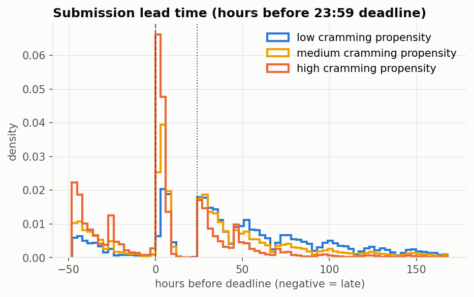

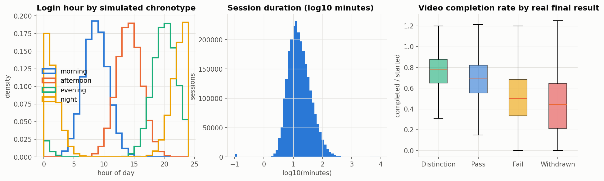

Each synthetic field is documented in `docs/DATA_DICTIONARY.xlsx` / `.md` (name, type, unit, valid range, generation
logic, source). The measurement scale of each field (nominal, ordinal, interval or ratio; Lecture 1) decides how it is
encoded later. The generator also writes audit files (latent traits, list of injected defects). These files are used
only to check the cleaning and are never used as model input.

<!-- pagebreak -->

## Module 2 — Exploratory Data Analysis

### 2.1 Distributions and outliers

Activity is strongly right-skewed: total clicks have skewness 3.0 and forum posts 9.5. 4,093 enrollments (12.6%) have
no activity in the course window. Using course-specific 3-IQR fences, 551 enrollments are extreme click outliers. They
are genuine heavy learners, not errors (Module 3).

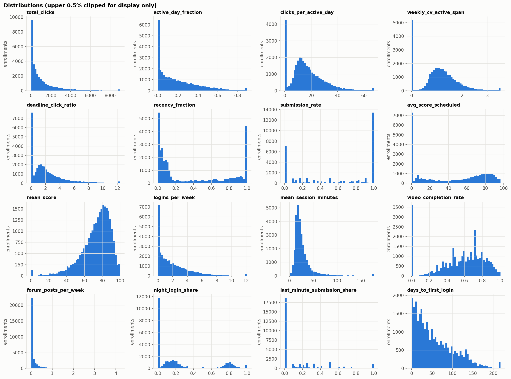

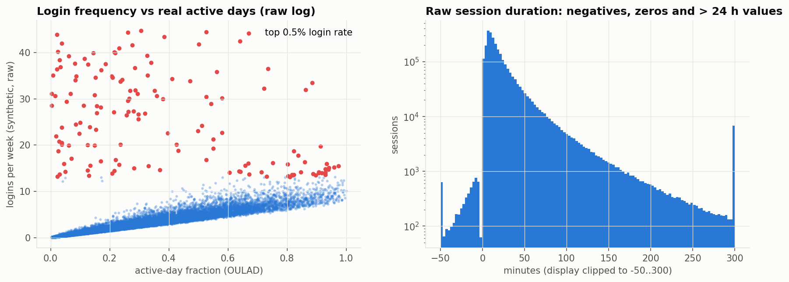

### 2.2 Correlations: two independent behavioural axes

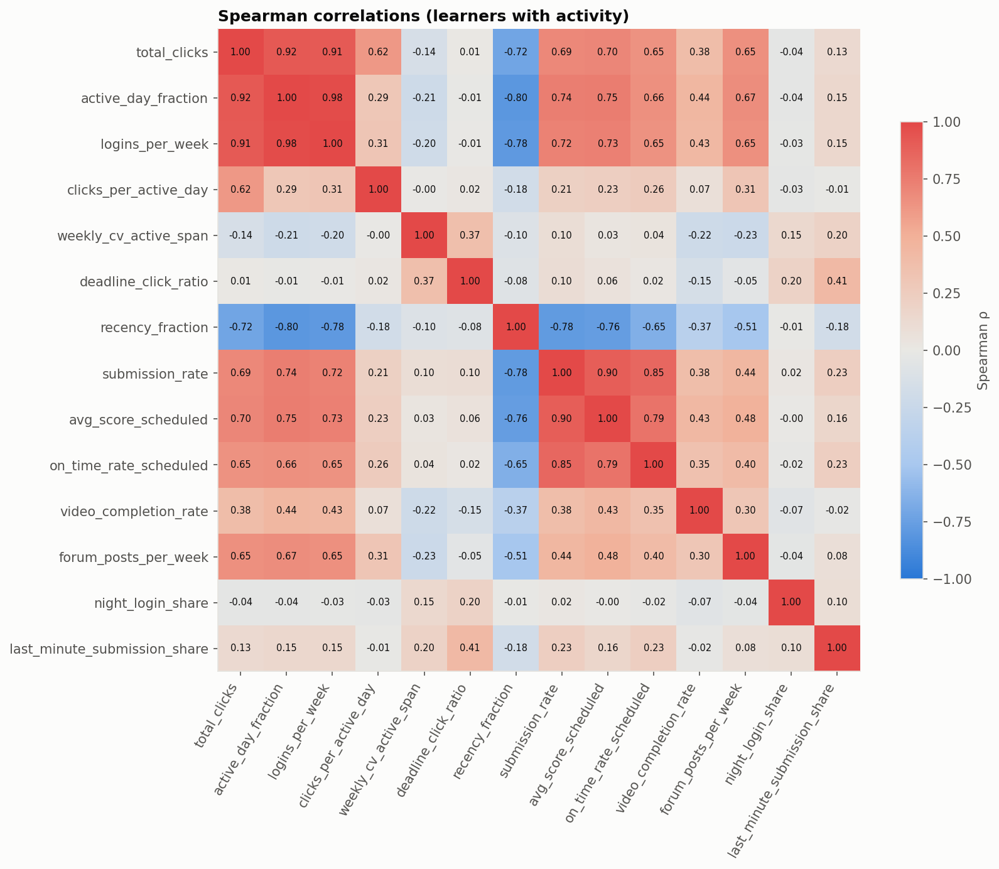

The Spearman matrix shows two independent groups of variables:
* **Volume and regularity:** clicks, active days, logins, submission rate and score, inter-correlated at ρ 0.7–0.99.
* **Pacing:** deadline concentration, burstiness, last-minute submission and night logins, almost independent of
  volume (|ρ| < 0.25).

The two axes are the basis for personas that are more than "high vs low activity".

### 2.3 Comparisons by course type, cohort and enrollment period

| Comparison | Result |
|---|---|
| Course type | STEM learners are *more* active (median active-day fraction 0.18 vs 0.11) but *more* at risk (55.2% vs 48.2%) and withdraw more (34% vs 25%) |
| Cohort | withdrawal rose from 28.8% / 26.8% (2013B / 2013J) to 33.5% / 34.0% (2014B / 2014J): a year effect, not a B-vs-J effect; this is a drift to monitor |
| Enrollment period | early registrants (> 60 days before start) are the most at risk (55.1%) vs 49.6–50.7% for later registrants |

Kruskal–Wallis tests with ε² effect sizes are in `reports/tables/m2_kruskal_tests.csv`. With n = 32k every test is
significant, so we interpret effect sizes.

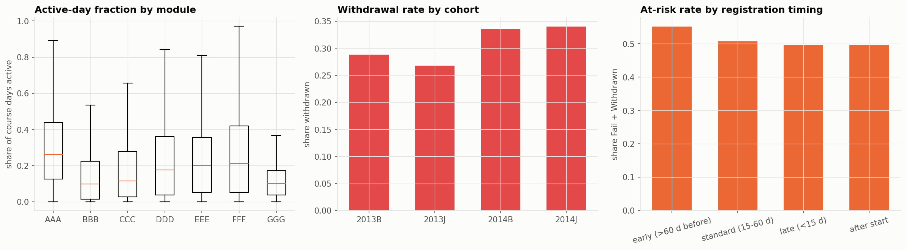

### 2.4 Relationships required by the brief

* **Login frequency vs final score:** ρ = 0.74, with diminishing returns. Scores rise steeply up to about 3–4
  logins/week and then flatten. Against the exam score alone the relationship is much weaker (ρ = 0.22).
* **Video completion vs submission timeliness:** ρ = 0.14. Watching videos does not make learners submit earlier, so
  timeliness is a separate behavioural dimension and enters the model on its own.

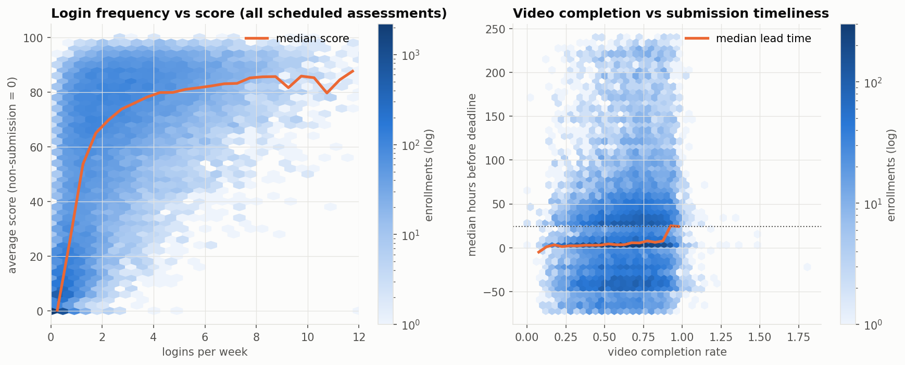

### 2.5 Time pattern (Lecture 8.1)

Weekly clicks, smoothed with exponential smoothing, have a seasonal component (peaks before each assessment
deadline) on a downward trend. Learners who later fail or withdraw are less than half as active as passers **from week
0**. Behaviour carries an early signal, which motivates the early-warning model in Module 6.

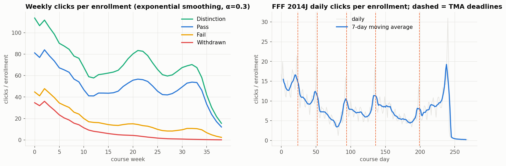

### 2.6 OLAP view (Lectures 2 and 4)

A DuckDB (column-store) star schema stores the enrollment data: `fact_enrollment` with `dim_learner`, `dim_course`
and `dim_presentation`. On it we run the OLAP operations:
* **roll-up:** `GROUP BY ROLLUP(domain, module)`;
* **drill-down and dice:** STEM × 2014 cohorts by IMD band;
* **slice and pivot:** at-risk rate by module × presentation.

The results are in `m2_olap_rollup.csv` and `m2_olap_pivot.csv`.

<!-- pagebreak -->

## Module 3 — Data Quality and Cleaning

### 3.1 Quality assessment

| Table | Rows | Completeness | Duplicate keys | Issue |
|---|---|---|---|---|
| studentInfo | 32,593 | 99.7% | 0 | IMD band missing (1,111) and spelled two ways ('10-20' vs '10-20%') |
| studentRegistration | 32,593 | 86.2% | 0 | unregistration date structurally missing for non-withdrawers |
| studentAssessment | 173,912 | 99.98% | 0 | 173 missing scores |
| vle | 6,364 | 72.5% | 0 | week_from / week_to mostly missing (unused) |
| synthetic_login_sessions | 2,709,570 | 99.8% | 21,505 | duplicates, messy labels, invalid durations, bots |

Referential integrity holds between all OULAD tables. Missing values are classified by mechanism (Lecture 7):
* *structural*, e.g. unregistration date for learners who did not withdraw: kept as NA;
* *MCAR-like*, e.g. session minutes: imputed and flagged;
* *not imputable*, e.g. IMD band: an explicit "Unknown" category.

### 3.2 Cleaning actions (each logged with rule, count and justification)

| Issue | Rule | Action | Affected |
|---|---|---|---|
| inconsistent label | IMD '10-20' | relabel to '10-20%' | 3,516 |
| missing | IMD null | 'Unknown' + flag (global constant) | 1,111 |
| duplicates | identical session rows | drop | 21,505 |
| inconsistent labels | 17 device spellings ('PC', ' desktop', 'DESKTOP' …) | map to desktop / mobile / tablet | 212,852 |
| invalid | session minutes < 0 or > 1440 | NA → learner-median imputation + flag | 8,071 |
| invalid | videos completed > started | cap at started | 8,064 |
| bot-like activity | ≥ 2 of 4 rules | drop automated sessions of flagged enrollments | 108,031 sessions / 114 enrollments |
| outliers | clicks > Q3 + 3 IQR within course | keep + flag; transform + winsorise in Module 4 | 551 |

No enrollment is removed: 32,593 → 32,593. The session log goes from 2,709,570 to 2,580,034 rows.

### 3.3 Bot detection: why multiple rules

A single box-plot rule (session count > Q3 + 3 IQR) finds 109 of the 114 bots but also flags **112 heavy human
learners**. We combine four independent signals and flag an enrollment when at least two fire:
1. extreme session count;
2. more than 30% sub-minute sessions;
3. automation user agent;
4. uniform login-hour entropy.

This rule detects all 114 injected bots with **precision 1.00 and recall 1.00**.

| Rule | Flagged | True bots | False positives | Precision | Recall |
|---|---|---|---|---|---|
| r1 extreme session count (IQR) | 221 | 109 | 112 | 0.49 | 0.96 |
| r2 sub-minute sessions | 124 | 114 | 10 | 0.92 | 1.00 |
| r3 automation user agent | 114 | 114 | 0 | 1.00 | 1.00 |
| r4 uniform login hours | 114 | 114 | 0 | 1.00 | 1.00 |
| **≥ 2 of 4** | **114** | **114** | **0** | **1.00** | **1.00** |

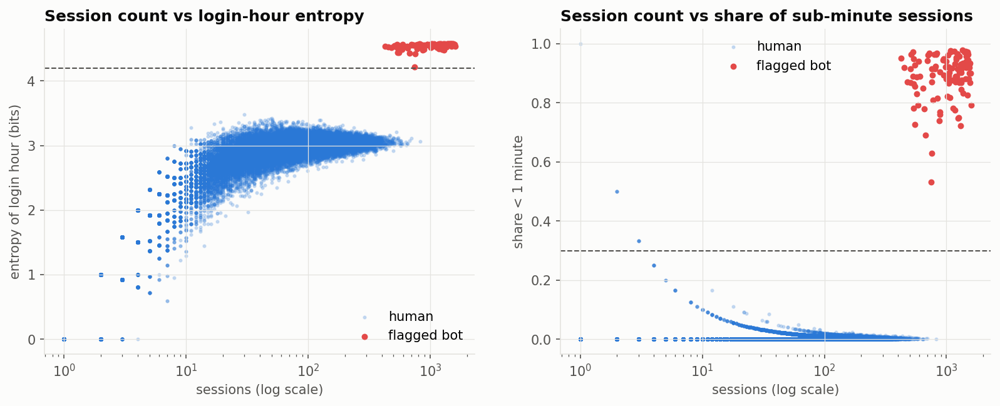

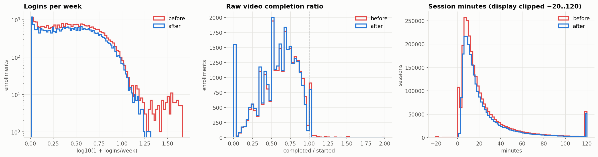

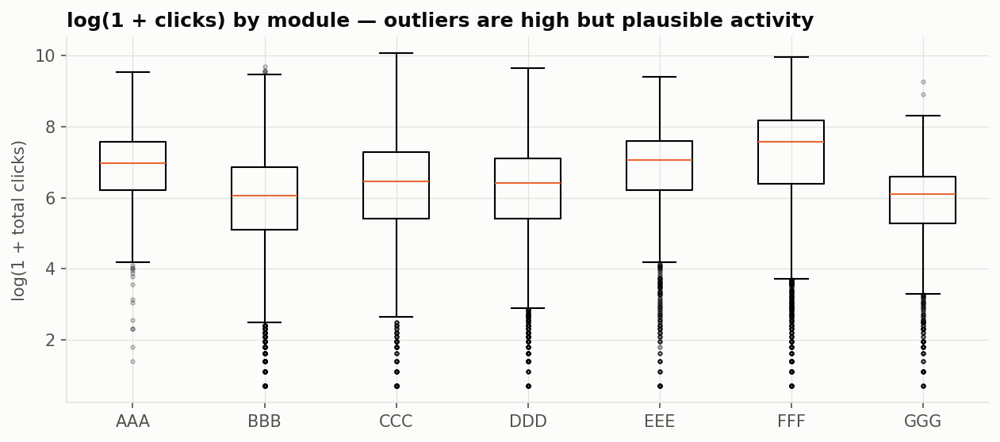

<!-- pagebreak -->

## Module 4 — Feature Engineering

### 4.1 Candidate features

We integrate the cleaned OULAD data and the session and submission aggregates into one row per enrollment, with 19
candidate behavioural features:

* **RFM:**
  * *Recency:* time since the last activity, as a fraction of course length.
  * *Frequency:* active-day fraction and logins per week.
  * *Monetary (intensity):* clicks per active day.
* **Consistency and pacing:** weekly burstiness within the active span; deadline click ratio (share of clicks on
  deadline days ÷ share of days that are deadline days); last-minute submission share; night-login share.
* **Performance:** average score over *scheduled* assessments, where a non-submission counts as 0; on-time rate.
* **Content and social:** video completion rate (smoothed); forum posts per week.

**Excluded on purpose:**
* demographics (gender, age, disability, IMD, region, education), to keep the segmentation fair. They are kept for
  profiling with one-hot and ordinal encodings;
* `final_result`, to avoid target leakage. It is used only for external validation.

### 4.2 Selection

We apply a redundancy filter: for every pair with |ρ| ≥ 0.80 we keep the more interpretable feature. This leaves 10
features with maximum remaining |ρ| = 0.80. For example, logins per week correlates 0.99 with active-day fraction and
is dropped.

| Role | Feature | Source |
|---|---|---|
| R | recency_fraction | OULAD |
| F | active_day_fraction | OULAD |
| M (intensity) | clicks_per_active_day | OULAD |
| Consistency | weekly_cv_active_span | OULAD |
| Pacing | deadline_click_ratio | OULAD |
| Performance | avg_score_scheduled | OULAD |
| Timeliness | last_minute_submission_share | synthetic |
| Content | video_completion_rate | synthetic |
| Social | forum_posts_per_week | synthetic |
| Rhythm | night_login_share | synthetic |

### 4.3 Transformation and scaling (Lecture 7)

| Feature | raw skew | log1p | Box-Cox(x+1) | Yeo-Johnson | rank-normal |
|---|---|---|---|---|---|
| total_clicks | 2.93 | −0.93 | −0.04 | −0.04 | 0.01 |
| clicks_per_active_day | 1.99 | −0.37 | 0.02 | 0.02 | 0.01 |
| deadline_click_ratio | 1.84 | 0.11 | 0.01 | 0.01 | 0.18 |
| forum_posts_per_week | 9.47 | 3.59 | 0.83 | 0.83 | 0.65 |

**Transformation.** Yeo-Johnson (the Box-Cox family, extended to zeros) brings skewness close to 0. Rank-normal
scores do as well, but they cannot be applied to a single new learner, so they are not suitable for deployment.

**Scaling.** Without scaling, `avg_score_scheduled` carries **99.8%** of the variance in the distance. After z-score
scaling every feature carries 10%. Min-max and robust scaling leave large imbalances (4.7–17.5%).

**Final pipeline:**
1. median fill;
2. winsorise at p0.5 / p99.5;
3. Yeo-Johnson on the skewed features;
4. z-score.

The pipeline is fitted on 2013B–2014B only. 2014J is held out as an unseen cohort.

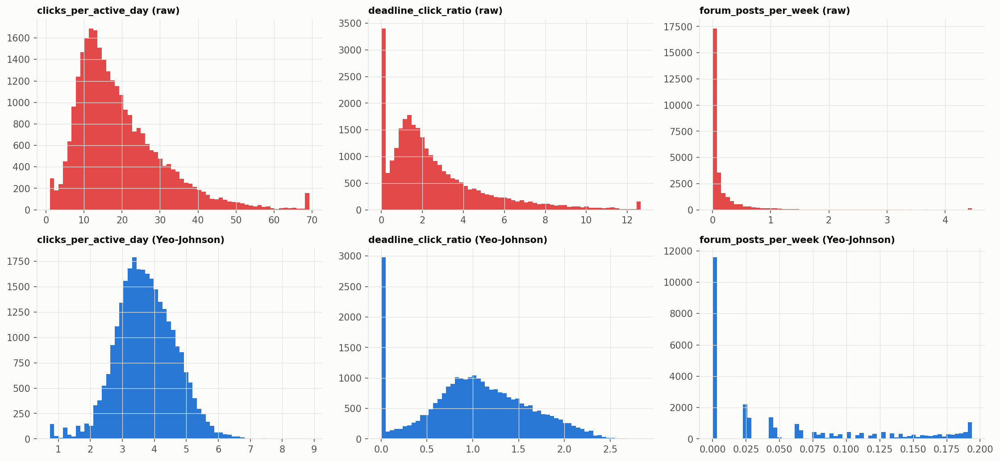

### 4.4 PCA

PC1 (33% of variance) is *engagement and performance*. PC2 (19%) is *pacing*, which confirms the two axes found in the
EDA. Five PCs are needed for 80% of the variance. Clustering on those five PCs does not improve separation measured in
the original space (silhouette 0.171 either way). We therefore cluster on the 10 interpretable features and use PCA
for visualisation.

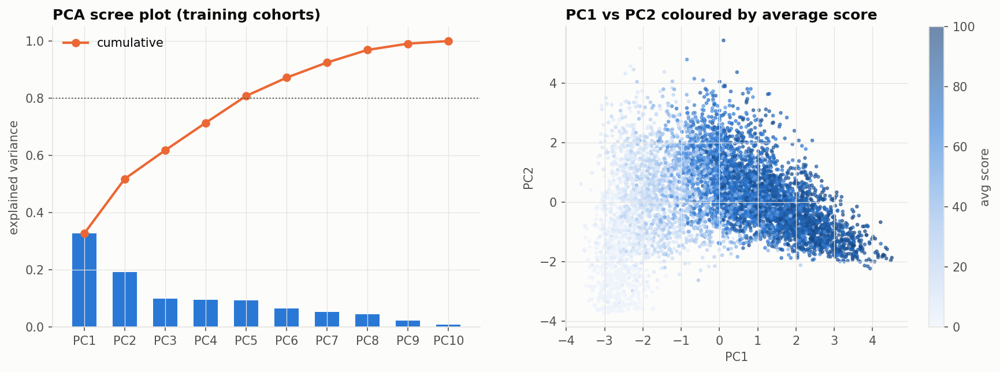

<!-- pagebreak -->

## Module 5 — Model Development

### 5.1 Is there structure?

The Hopkins statistic is **0.76**, well above 0.5, so the data has clustering tendency. Non-starters (no activity) form
a degenerate point mass, so they are assigned by rule as **S0**. They are not allowed to distort the K-Means
centroids.

### 5.2 K-Means: choosing k

We scan k = 2…10 and compute for each:
* SSE (elbow);
* five-fold held-out SSE (cross-validation);
* silhouette, Davies–Bouldin and Calinski–Harabasz;
* bootstrap ARI over 20 resamples;
* seed ARI.

| k | Silhouette | Davies–B. | CH | Min share | Bootstrap ARI mean / min | Seed ARI |
|---|---|---|---|---|---|---|
| 2 | 0.242 | 1.69 | 5852 | 37.4% | 0.98 / 0.92 | 0.99 |
| **3** | **0.206** | **1.68** | **5208** | **24.2%** | **0.96 / 0.90** | **0.98** |
| 4 | 0.170 | 1.84 | 4378 | 19.3% | 0.92 / 0.70 | 0.72 |
| 5 | 0.183 | 1.71 | 3857 | 10.1% | 0.80 / 0.60 | 0.76 |
| 6 | 0.174 | 1.73 | 3580 | 8.9% | 0.94 / 0.69 | 0.64 |

The elbow (chord distance) points to k = 4, but k ≥ 4 is **not stable**: bootstrap ARI minimum < 0.80, and different
seeds give different partitions. We require stability ≥ 0.80. Among the stable k, k = 3 has the best Davies–Bouldin
score and splits the active learners into actionable groups. k = 2 only separates "high" from "low". The empirical
rule √(n/2) ≈ 97 is far too large for actionable personas.

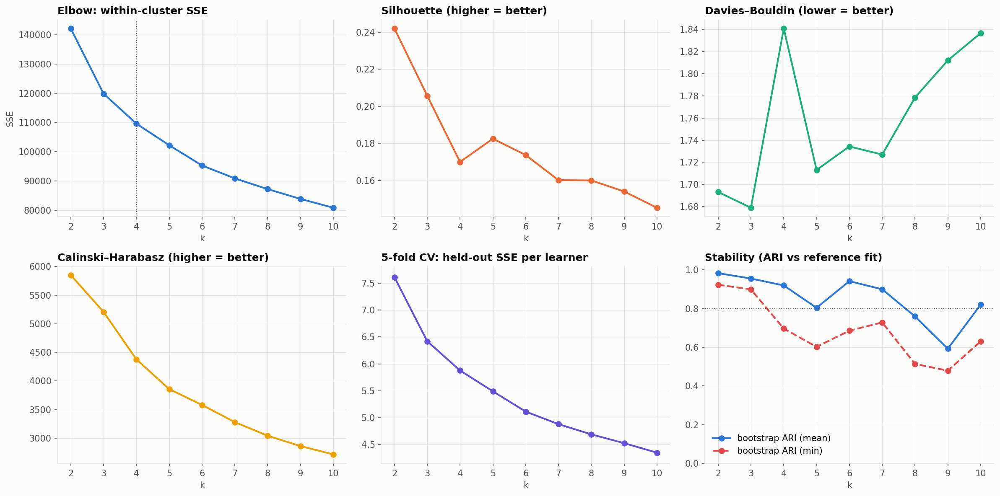

### 5.3 Hierarchical clustering (AGNES)

Linkages are compared on a 6,000-learner sample, because memory grows with O(n²):

| Linkage | Cophenetic r | Silhouette | Largest cluster |
|---|---|---|---|
| single | 0.31 | 0.21 | 99.97% (chaining) |
| complete | 0.48 | 0.10 | 41.8% |
| average | 0.61 | 0.16 | 96.8% |
| Ward | 0.52 | 0.15 | 39.0% |

Single and average linkage chain everything into one cluster, the classic weakness taught in Lecture 9. Ward gives
balanced clusters but agrees with K-Means only moderately (ARI 0.44). It also cannot assign new learners without
refitting.

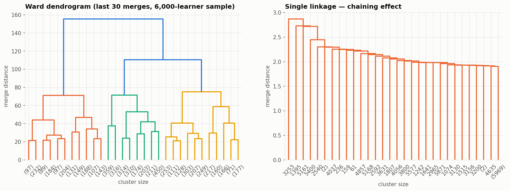

### 5.4 DBSCAN

The k-distance graph (k = MinPts = 20) suggests Eps ≈ 1.4. The Eps × MinPts grid shows that the data is **one dense
continuum** with sparse fringes. The best setting (≤ 10% noise, ≥ 2 clusters) gives one cluster with 91% of learners,
plus 8% noise. DBSCAN is therefore used as an outlier lens, not as the segmentation.

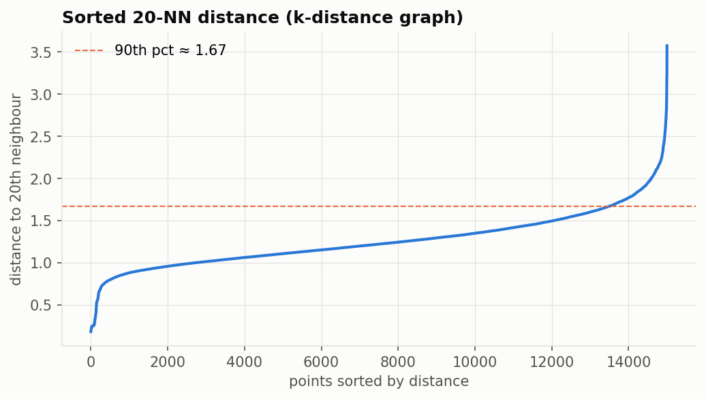

### 5.5 Algorithm comparison and choice

| Algorithm | Clusters | Silhouette | Davies–B. | Largest cluster | Stability | Assigns new learners |
|---|---|---|---|---|---|---|
| **K-Means (k = 3)** | 3 | 0.206 | 1.68 | 38% | 0.96 | yes (nearest centroid) |
| Agglomerative Ward | 3 | 0.150 | 2.02 | 39% | 0.44 vs K-Means | no |
| DBSCAN (1.4, 20) | 2 + noise | 0.253 | 0.96 | 91% | – | partly |

DBSCAN has the highest silhouette, but only because it puts almost everyone in one cluster, which is useless for
tailoring. **K-Means** is selected because it has the best balance of separation, stability, scalability (O(nkt)) and
instant assignment in the API.

### 5.6 Validation

* **Internal:** silhouette 0.21 is typical of behavioural data that forms a continuum. Every cluster has a positive
  mean silhouette, and fewer than 2% of members have a negative silhouette.
* **External** (outcome never used): purity 0.63, NMI 0.31, ARI 0.23 against `final_result`. Segments describe
  behaviour, not outcomes, so a moderate value is expected. What matters is that pass rates differ sharply by segment.
* **Temporal:** the frozen model on the unseen 2014J cohort has silhouette 0.19, and ARI 0.84 against a K-Means refit
  on 2014J.
* **Robustness:** a model built only on real OULAD features agrees with the full model at ARI 0.69, so the core
  structure comes from real data, not from the synthetic layer.
* **Explainability (Lecture 10):** a depth-4 decision tree reproduces the segments with **87%** accuracy on test and
  2014J. Its rules are shown in the dashboard. The main splits are active-day fraction (importance 0.47), recency
  (0.33) and deadline click ratio (0.07).

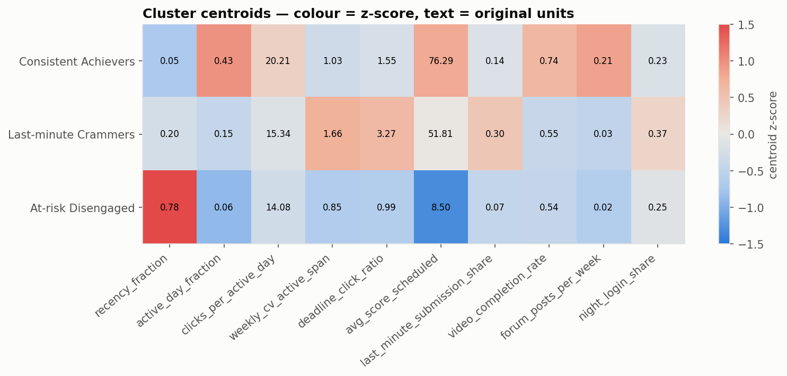

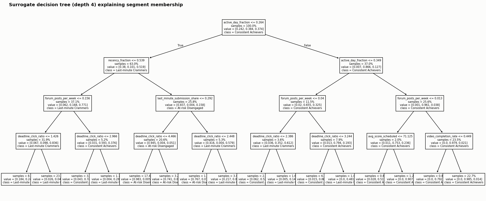

<!-- pagebreak -->

## Module 6 — Personas, Recommendations and Deployment

### 6.1 Personas

Clusters are named by matching their centroids to predefined behavioural archetypes (Hungarian assignment). Names
therefore stay consistent when the model is refit.

| Median | S0 Non-starters | S1 Consistent Achievers | S2 Last-minute Crammers | S3 At-risk Disengaged |
|---|---|---|---|---|
| active-day fraction | 0 | 0.41 | 0.14 | 0.03 |
| recency (fraction of course since last activity) | 1.00 | 0.03 | 0.10 | 0.84 |
| deadline click ratio | – | 1.5 | **3.4** | 0.7 |
| last-minute submission share | – | 0.08 | **0.25** | 0 |
| hours before deadline (median) | – | **41** | 2.7 | 4.8 |
| average score (scheduled) | 0 | **80** | 58 | 5 |
| forum posts / week | 0 | 0.23 | 0 | 0 |
| logins / week | 0 | 3.9 | 1.3 | 0.3 |
| pass rate | 0.1% | 89.6% | 53.3% | 0.3% |
| withdrawal rate | 88.5% | 3.0% | 16.0% | 65.0% |

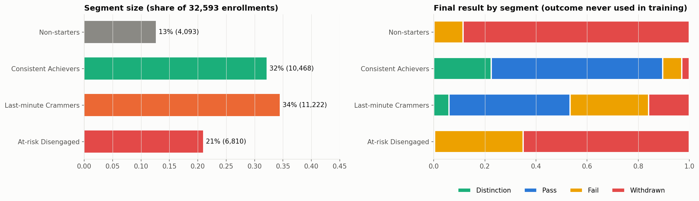

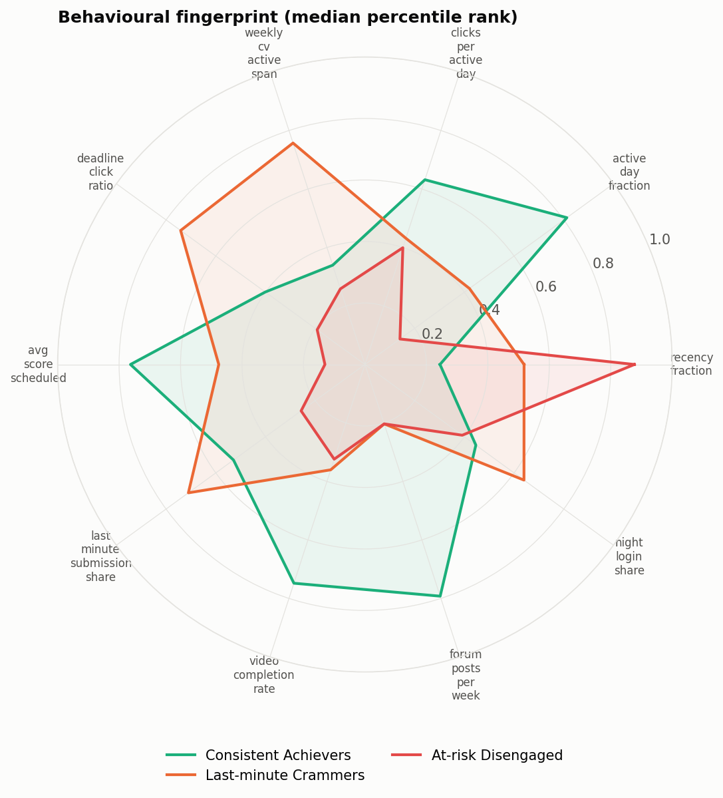

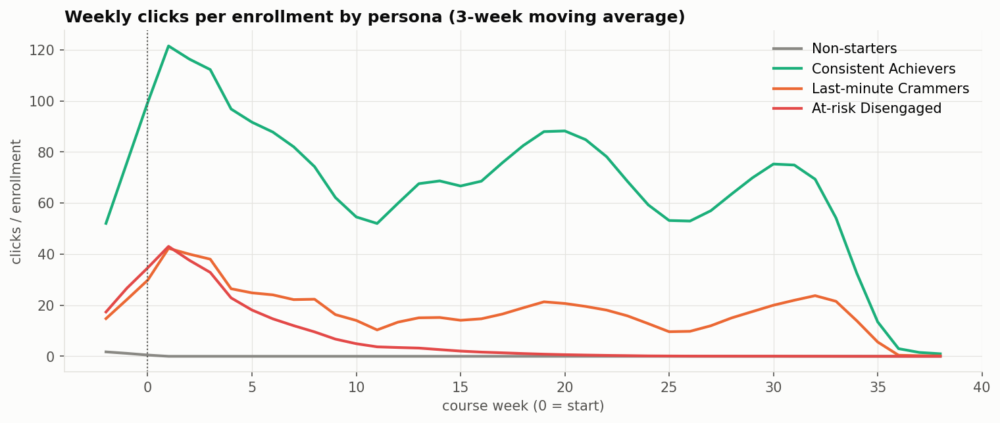

At-risk Disengaged and Crammers start with **the same first-month activity**: a median of 39.5 vs 39.3 clicks. They
separate after week ~10, when S3 learners stop. This explains why early detection of S3 is hard (§6.3) and why the
14-day inactivity alert is the key intervention.

### 6.2 Tailored content, pacing and support

| Persona | Content | Pacing | Support | KPI to track |
|---|---|---|---|---|
| Non-starters | short "first-hour" orientation, the first activity unlocked immediately | welcome sequence day 1 / 3 / 7 | tutor call by day 10; deferral / withdrawal-refund advice | share active by day 14 |
| At-risk Disengaged | catch-up pathway with essential content only | flexible deadlines on request | alert at 14 days inactive → tutor outreach | re-engagement within 14 days of alert |
| Last-minute Crammers | split assessments into weekly micro-tasks, short videos | mini-deadlines 3–5 days before each due date | study-plan coaching; deadline reminders 72 h before | share submitted > 24 h before deadline |
| Consistent Achievers | enrichment and stretch material | self-paced | peer-mentor role, forum moderation; no paid support | distinction rate, mentor uptake |

**Fairness.** Demographics are not model inputs. The association between segment and each attribute is weak
(Cramér's V: gender 0.05, disability 0.06, education 0.08, IMD 0.09, age 0.10, course domain 0.11).

### 6.3 Early warning on day 28 (Lecture 10)

Segments use the whole course, but support must start early. A random forest predicts the segment from information
available after 28 days. It is trained on 2013B–2014B and tested on unseen 2014J.

| Class | Precision | Recall |
|---|---|---|
| Non-starters | 0.90 | **1.00** |
| Consistent Achievers | 0.74 | 0.77 |
| Last-minute Crammers | 0.67 | 0.62 |
| At-risk Disengaged | 0.55 | 0.55 |

Balanced accuracy is **0.74** (chance level is 0.25). Non-starters can be found with near certainty in the first
month. At-risk Disengaged is the weakest class because those learners still look like Crammers. We recommend a
weekly-refreshed watch list, confirmed by tutors.

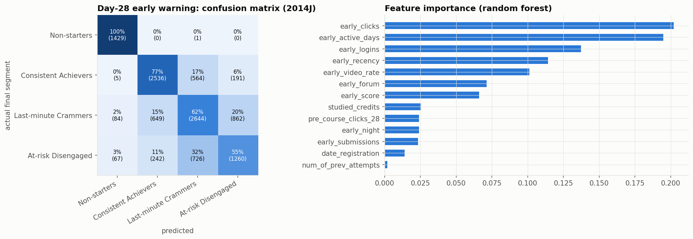

### 6.4 Decision analysis (Lecture 2)

For each persona we compare EV(no action) = pass rate × $400 with EV(intervene) = (pass rate + uplift) × $400 − cost.
The uplift is scaled by the segment's headroom. Costs already spent are sunk and excluded.

| Persona | Best intervention | Uplift | Cost | Net gain / learner | Break-even uplift |
|---|---|---|---|---|---|
| At-risk Disengaged | tutor outreach call | 15 pp | $35 | **+$25.0** | 8.8 pp |
| Last-minute Crammers | study-plan coaching | 9.6 pp | $15 | **+$23.4** | 3.8 pp |
| Non-starters | tutor outreach call | 12 pp | $35 | +$13.0 | 8.8 pp |
| Consistent Achievers | automated nudges | 0.4 pp | $2 | **−$0.4** | 0.5 pp |

Support for Achievers destroys value. For the other segments the decision is positive as long as the true uplift is
above the break-even uplift. The sensitivity chart shows how the decision changes with uplift.

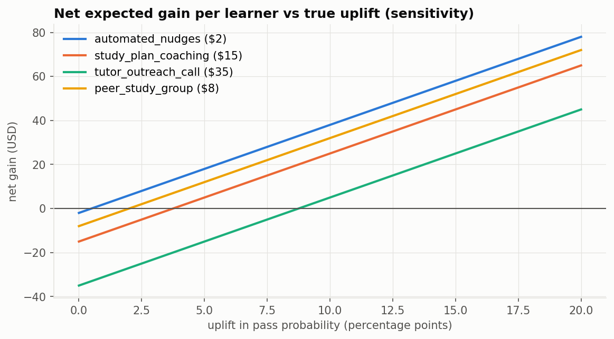

### 6.5 Optimisation (Lecture 3.2)

The LP, solved with scipy HiGHS, chooses how many learners of each segment receive each intervention:
* **Objective:** maximise expected extra passes.
* **Constraints:** budget $60,000; tutor time 600 hours; each learner receives at most one intervention; no option with
  negative EV.
* **Data:** 2014J segment sizes.

| Segment | Intervention | Learners | Spend | Extra passes |
|---|---|---|---|---|
| Last-minute Crammers | study-plan coaching | 1,800 | $27,000 | 172.8 |
| Last-minute Crammers | automated nudges | 2,439 | $4,878 | 58.5 |
| At-risk Disengaged | automated nudges | 2,295 | $4,590 | 36.7 |
| Non-starters | automated nudges | 1,430 | $2,860 | 28.6 |
| **Total** | | **7,964** | **$39,328** | **296.7** |

| Policy | Learners | Extra passes | Spend | Cost per extra pass |
|---|---|---|---|---|
| segment-blind tutor calls (same tutor hours) | 800 | 66.1 | $28,000 | $423.6 |
| **segment-targeted LP** | 7,964 | 296.7 | $39,328 | **$132.6** |

**Sensitivity (shadow prices).** The budget constraint is **not binding**: its shadow price is 0, and $20.7k is
unspent. **Tutor time is binding.** One extra tutor hour adds about 0.22 passes, worth about $86, which is more than
its cost. The recommendation is therefore to buy tutor hours, not to raise the budget. Tutor time goes to coaching for
Crammers, where it buys the most passes per minute.

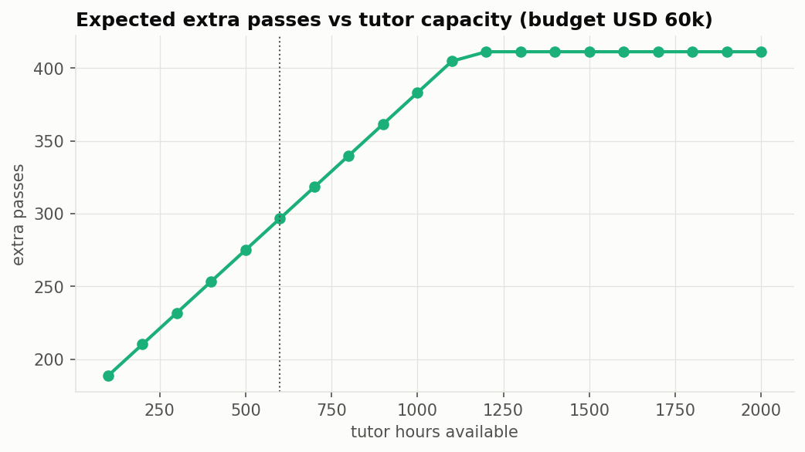

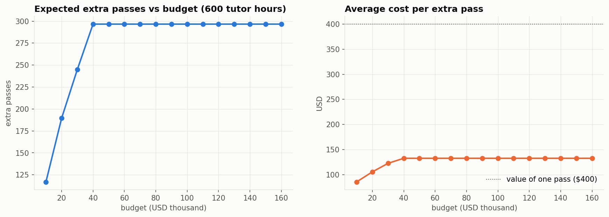

### 6.6 Deployment as a decision-support system (Lecture 3.1)

The system has the three DSS components:
* **data management:** learner lookup table and feature store (Parquet);
* **model management:** versioned feature pipeline, K-Means, persona rules and surrogate tree (joblib);
* **user interface:** a Streamlit dashboard for learner-success staff and tutors.

The components are connected through a **FastAPI** service.

| Endpoint | Purpose |
|---|---|
| `GET /health`, `GET /segments` | status, model version, persona catalogue |
| `POST /predict` | assign one learner from the 10 engineered features |
| `POST /predict/raw` | assign from raw LMS counts (active days, clicks, scores, videos, logins …), using the training definitions |
| `POST /predict/batch` | assign many learners; returns segment counts |
| `GET /learners/{id_student}` | segment, confidence and recommendations of an existing learner |
| `GET /explain/rules`, `GET /monitoring/latest` | decision rules, latest monitoring verdict |

Every response contains the segment, persona, assignment confidence, an atypical flag (distance beyond the training
p95), the top drivers and the recommended actions. Pydantic validation rejects impossible inputs, and all 7 invalid
test cases are rejected (422 / 404). The served assignments agree **100%** with the training notebook on 2,000
learners. Median latency is 49 ms per request. Predictions are logged for monitoring.

The dashboard has six tabs: KPI overview with module / cohort / course-type filters, segment profiles, learner lookup,
assignment of a new learner (through the API, falling back to the in-process model), monitoring, and the model card.

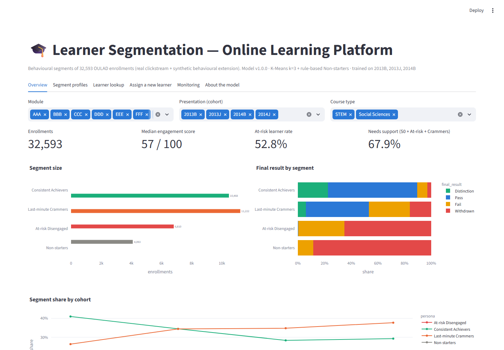

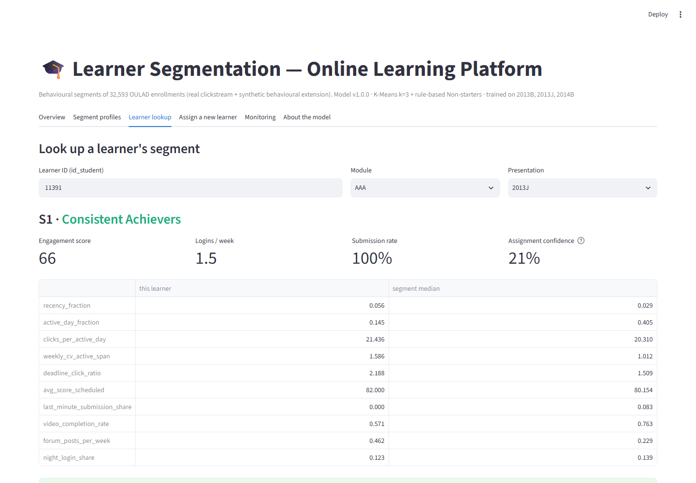

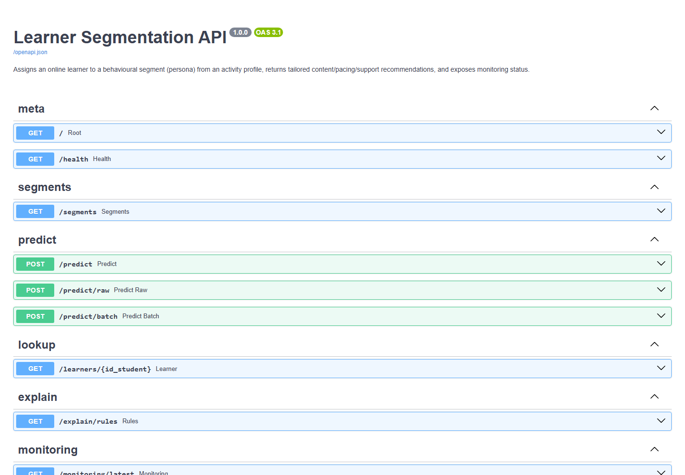

The cloud configuration is included: `render.yaml` (Render blueprint for the API and dashboard), Streamlit Community
Cloud settings and a `Dockerfile` for Hugging Face Spaces. Instructions are in `docs/DEPLOYMENT.md`. Live links:
https://learner-segmentation-api.onrender.com · https://learner-segmentation-dashboard.onrender.com.

<!-- pagebreak -->

## Module 7 — Model Monitoring

### 7.1 Signals and triggers

| Check | Signal | AMBER | RED |
|---|---|---|---|
| Feature drift | PSI per feature (10 reference quantile bins) | any > 0.10 | ≥ 2 features > 0.25 |
| Segment share | largest change of a segment's share | > 5 pp | > 10 pp |
| Centroid shift | K-Means refit on the batch, matched to production centroids (Hungarian), mean shift in SD | > 0.30 | > 0.50 |
| Atypical share | distance to nearest centroid > training p95 (expected 5%) | > 8% | > 15% |
| Structure | silhouette drop vs training | – | > 0.05 |

**Decision rule:**
* ≥ 2 RED → **RE-CLUSTER**;
* 1 RED or any AMBER → **INVESTIGATE**;
* otherwise **NO ACTION**.

KS tests and the Evidently report are kept as supporting evidence. Their p-values are not used as triggers, because
with about 10,000 learners almost any difference is "significant". The full procedure is in
`docs/MONITORING_PLAYBOOK.md`.

### 7.2 Results

| Batch | Max PSI | Features RED | Share shift | Centroid shift | Atypical | Evidently drifted | Decision |
|---|---|---|---|---|---|---|---|
| 2014J (real, unseen) | 0.07 | 0 | 4.9 pp | 0.27 SD | 4.7% | 2 / 10 | **NO ACTION** |
| Stress scenario (simulated platform change) | > 0.25 | 6 | 19.9 pp | 1.83 SD | 12.3% | 7 / 10 | **RE-CLUSTER** |

The stress scenario simulates a platform redesign combined with exam-season pressure. Active learners study on
20–45% fewer days, shift about 25 pp of logins to the night, submit more at the last minute, concentrate 1.3–1.9× more
activity on deadline days, and complete 15 pp fewer videos. The triggers fire as designed. On the real cohort they stay
green, so the system neither raises false alarms nor misses real change.

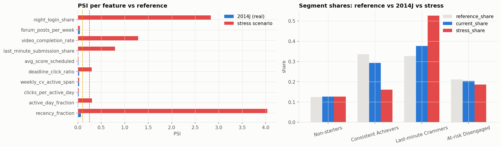

### 7.3 Stability over time

| Cohort | Silhouette | Centroid shift (SD) | Atypical | Achievers | Crammers | At-risk | Non-starters |
|---|---|---|---|---|---|---|---|
| 2013B | 0.222 | 0.36 | 4.4% | 40.9% | 26.4% | 21.9% | 10.9% |
| 2013J | 0.199 | 0.15 | 5.6% | 34.4% | 34.4% | 19.5% | 11.8% |
| 2014B | 0.193 | 0.25 | 4.8% | 28.4% | 34.7% | 22.6% | 14.3% |
| 2014J | 0.193 | 0.27 | 4.7% | 29.3% | 37.7% | 20.4% | 12.7% |

The structure is stable, but the mix is moving: Consistent Achievers fell from 41% to 29%, and Last-minute Crammers
rose from 26% to 38%. This matches the rise in withdrawal found in the EDA. The playbook adds a trend rule: if the
same segment moves in the same direction for three cohorts, the status becomes INVESTIGATE.

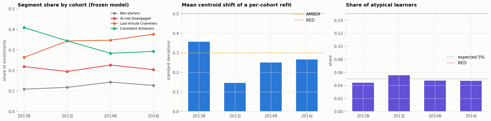

Evidently HTML reports: `monitoring/evidently_drift_2014J.html` and `monitoring/evidently_drift_stress_scenario.html`.
They are also embedded in the dashboard's Monitoring tab.

<!-- pagebreak -->

## Module 8 — Recommendations, Limitations and Lecture Alignment

### 8.1 Recommendations to the business

1. **Replace blanket support with segment-targeted support.** The LP plan gives 3× the extra passes per dollar of
   segment-blind tutor calls.
2. **Act on Non-starters in the first 10 days.** They are 12.6% of enrollments, almost all withdraw, and they are
   detected with near-perfect recall. Use a welcome sequence and a tutor call.
3. **Fix pacing for Crammers, the largest segment (34%).** Mini-deadlines and study-plan coaching give the best return
   on tutor time. Measure the share of work submitted more than 24 h before the deadline.
4. **Alert on 14-day inactivity** to catch At-risk Disengaged learners before week 10. In month 1 they cannot be told
   apart from Crammers.
5. **Spend nothing extra on Consistent Achievers.** Offer peer-mentor roles that create support capacity for the other
   segments.
6. **Buy tutor hours before raising the budget.** Tutor time is the binding constraint, and a tutor hour is worth
   about $86 in expected retained value.
7. **Validate the uplift assumptions with an A/B test** per segment in the next cohort, then re-optimise.
8. **Watch the Achiever → Crammer trend.** If 2015B continues it, investigate course and assessment design changes.

### 8.2 Limitations

* **Synthetic layer.** Login, video, forum and submission-hour fields are plausible simulations, not observations.
  Their links to outcomes partly reflect the generation logic. Mitigations: they are anchored to real behaviour, every
  field is documented, and the OULAD-only model agrees at ARI 0.69. Replace them with real telemetry when available.
* **Retrospective segments.** They use the whole course. The day-28 early-warning model bridges this gap, but its
  recall for At-risk Disengaged is only 0.55.
* **Clicks are not learning time.** Course design changes activity levels, so profiles should be read in module
  context.
* **Moderate separation (silhouette 0.21).** Behaviour is a continuum. The segments are stable and actionable but not
  sharply separated, which is why the API reports a confidence and an atypical flag.
* **Assumed economics.** Uplifts, costs and the value of a pass are planning assumptions. Sensitivity analysis shows
  where decisions flip.
* **Duplicates in the click log** (7.4%) are kept because OULAD has no event id. Removing them changes window clicks
  by about 3%.

### 8.3 Alignment with the course lectures

| Lecture | Applied in |
|---|---|
| 1 Introduction to BA | analytics types per module; KPIs; measurement scales in the data dictionary |
| 2 Decision analysis, OLAP | EV decision tree per persona, sunk costs; DuckDB star schema with roll-up, drill-down, slice, dice, pivot |
| 3.1 DSS | data / model / UI subsystems: lookup store, model registry, dashboard + API |
| 3.2 Optimisation | LP allocation under budget and tutor-hour constraints; shadow prices; sensitivity curves |
| 4 Data warehouse, column store | Parquet + DuckDB columnar storage, fact and dimension tables |
| 5–6 Spark, Pair RDD, DataFrame | 10.6M-row ETL with DataFrame API; reduceByKey cross-check |
| 7 Data preparation | missing-value mechanisms and treatments, IQR / z outliers, multi-rule bot detection, Box-Cox / Yeo-Johnson, min-max vs z-score, one-hot / ordinal, PCA |
| 8 Data mining / KDD | notebook sequence follows the KDD stages |
| 8.1 Time series | trend and seasonality of weekly clicks, moving average, exponential smoothing, cohort tracking |
| 9 Clustering | K-Means, AGNES linkages, DBSCAN with k-distance; elbow, √(n/2), cross-validated SSE; silhouette, DB, CH, purity, NMI, ARI; stability |
| 10 Classification | surrogate decision tree; random-forest early warning with train/test split and confusion matrix |

A detailed mapping is in `docs/LECTURE_ALIGNMENT.md`.

### 8.4 Deliverables

| Deliverable | Location |
|---|---|
| Notebooks (one per module) | `notebooks/01 … 08_*.ipynb` (executed), sources in `notebooks/_src` |
| Reusable code | `src/edtech/` (ETL, synthetic generator, cleaning, features, modeling, monitoring, serving) |
| Data dictionary | `docs/DATA_DICTIONARY.xlsx`, `docs/DATA_DICTIONARY.md` |
| API / dashboard | `app/api/main.py`, `app/dashboard/app.py`; `render.yaml`, `Dockerfile` |
| Monitoring report | `monitoring/*.html` (Evidently), `docs/MONITORING_PLAYBOOK.md` |
| Model card | `docs/MODEL_CARD.md` |
| Tests | `tests/` (pytest: definitions, cleaning validity, API, dashboard) |
| Report and slides | `reports/Final_Report.pdf / .docx`, `reports/Final_Presentation.pptx`, `reports/modules/` |

### 8.5 Reproducibility

The pipeline runs end to end with `python scripts/run_notebooks.py`, in about 10 minutes on a laptop. Every random
step uses seed 42. Raw files are verified by SHA-256 (`data/raw/raw_manifest.json`). All numbers in this report are
read from `reports/metrics/*.json` and `reports/tables/*.csv`, which the notebooks produce.
