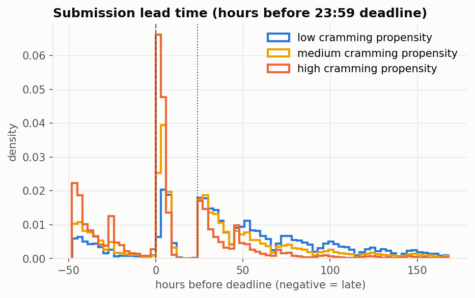
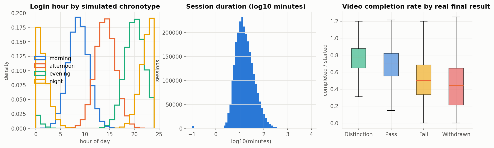

# Module 1 — Business Understanding and Data Generation

## 1.1 Problem and stakeholders

The platform offers the same support to every learner. As a result, 52.8% of enrollments end in Fail or Withdrawn.
Calling every learner would cost $1.14M; calling every at-risk learner would cost $602k. Neither is affordable, and
both spend tutor time on learners who do not need it.

| Stakeholder | Decision | What they need from the analysis |
|---|---|---|
| Head of Learner Success | budget and tutor capacity per cohort | segment sizes, expected uplift, cost per extra pass |
| Course designers | content format and pacing | how each group studies (deadline concentration, video use) |
| Tutors | whom to contact, when, how | learner lookup, early-warning list, recommended action |
| Data / MLOps team | when to retrain | drift and stability monitoring |

The work covers all three types of analytics (Lecture 1):
* **Descriptive:** EDA and persona profiles.
* **Predictive:** segment assignment of new learners, day-28 early warning and drift detection.
* **Prescriptive:** expected-value decision trees and LP allocation of interventions.

## 1.2 KPIs

| KPI | Definition | Baseline |
|---|---|---|
| Engagement score | 0–100, weighted percentile of active days, clicks, submission rate, timeliness, video completion and forum use | median 82 (Distinction) / 75 (Pass) / 41 (Fail) / 25 (Withdrawn) |
| At-risk learner rate | share of enrollments ending in Fail or Withdrawn | 52.8% (withdrawal 31.2%, pass 47.2%) |
| Intervention cost | Σ (learners × unit cost) per intervention; tutor minutes tracked separately | blanket at-risk tutor calls: $602,280 |
| Cost per additional pass | intervention spend ÷ expected additional passes | segment-blind tutor calls $424 |

Intervention catalogue (planning assumptions, varied in sensitivity analysis): automated nudges $2 (base uplift 2 pp),
peer study group $8 and 10 tutor minutes (4 pp), study-plan coaching $15 and 20 minutes (6 pp), tutor outreach call
$35 and 45 minutes (10 pp). A retained pass is valued at $400.

## 1.3 Data sources and Spark ETL

OULAD is the required base dataset (Kaggle: kaggle.com/datasets/anlgrbz/student-demographics-online-education-dataoulad;
original source Kuzilek et al., 2017, *Scientific Data* 4:170171, CC BY 4.0). It has seven tables. The click log `studentVle` (10,655,280 rows, 454 MB) is processed with **PySpark**
(Lectures 5–6):
* read with an explicit schema;
* broadcast join with the `vle` activity dimension;
* `groupBy` to one row per enrollment-day, giving 1,808,119 rows;
* `pivot` by activity type;
* an independent **Pair-RDD `map → reduceByKey`** job recomputes total clicks per enrollment. Both give exactly
  39,605,099 clicks.

The log contains 787,170 exact duplicate rows (7.4%). OULAD has no event id, so they are kept and documented as a
sensitivity.

## 1.4 Synthetic behavioural extension

The announcement asks for login frequency, video completion and submission timeliness at hour level. OULAD does not
record these. We generate them with **Faker** (uuid4 session ids, realistic user agents) and numpy (seed 42), following
explicit business logic. Each learner's synthetic behaviour is conditioned on their real record, so the extension is
consistent with what actually happened:

* **Login sessions** occur only on the learner's real active days. The number per day depends on that day's real
  clicks and on a learner-level habit. Check-in logins are added; login hour follows a chronotype by age band, and
  device depends on age.
* **Video completion** follows a Beta propensity driven by real engagement and score. **Forum posts** follow real
  forum clicks.
* **Submission hour** refines the real submission day. Learners who concentrate activity on deadline days submit
  closer to the deadline.
* **Realistic defects** are injected so that cleaning can be tested against ground truth: 0.8% duplicate rows, 8%
  messy device labels, missing and impossible durations, completed > started videos, and 0.4% bot accounts.

| Anchor check (Spearman ρ) | Value |
|---|---|
| synthetic logins vs real active days | 0.986 |
| hours before deadline vs real days submitted early | 0.911 |
| forum posts vs real forum clicks | 0.819 |
| video completion vs real average score | 0.489 |
| night-login share vs real deadline click ratio | 0.215 |

Each synthetic field is documented in `docs/DATA_DICTIONARY.xlsx` / `.md` (name, type, unit, valid range, generation
logic, source). The measurement scale of each field (nominal, ordinal, interval or ratio; Lecture 1) decides how it is
encoded later. The generator also writes audit files (latent traits, list of injected defects). These files are used
only to check the cleaning and are never used as model input.

<!-- pagebreak -->
