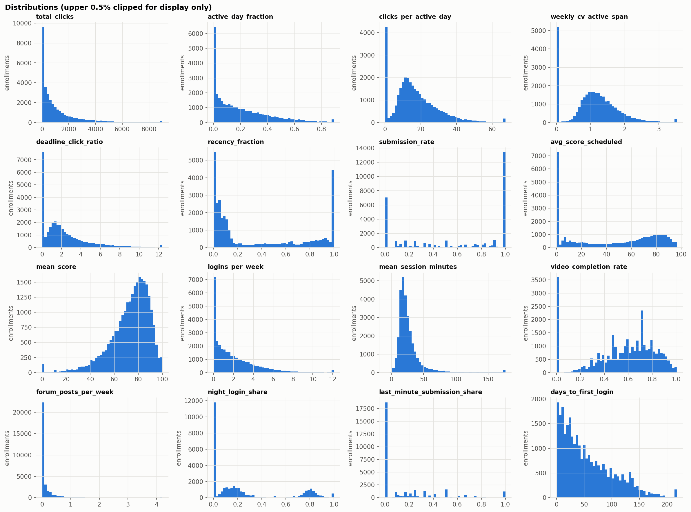
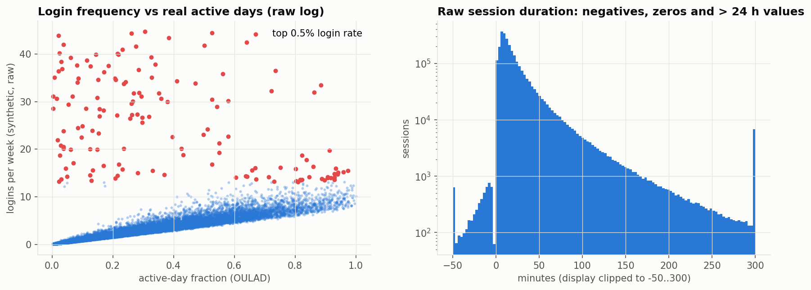
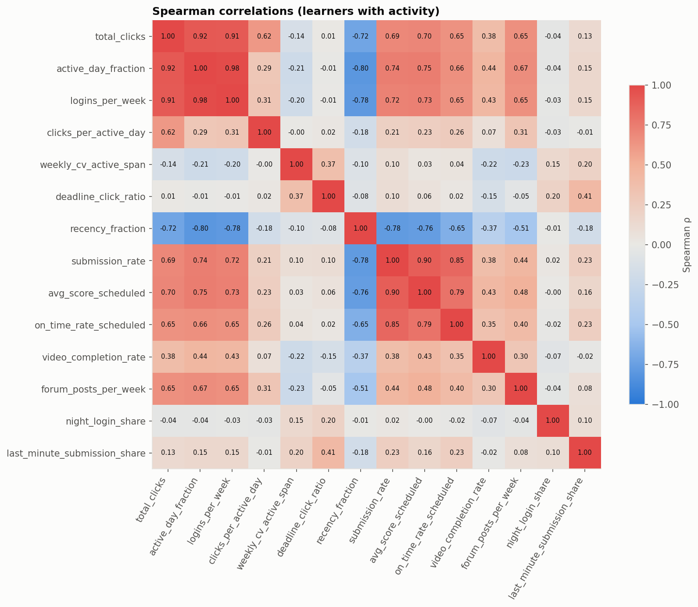
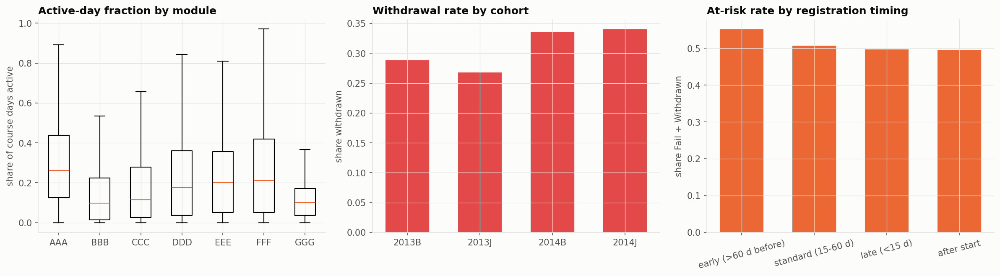
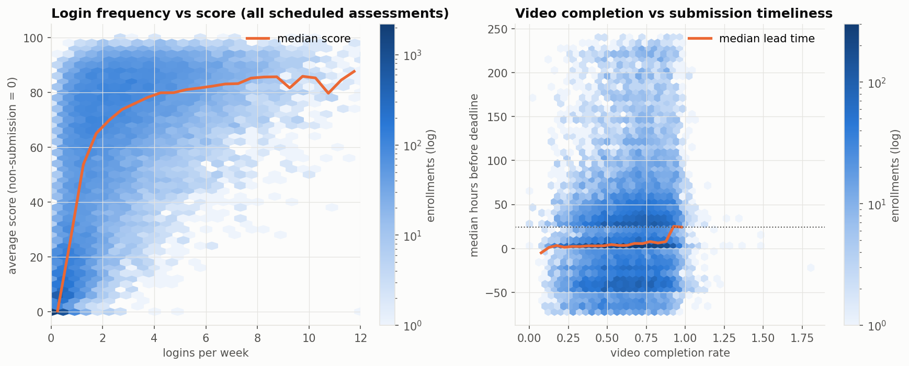
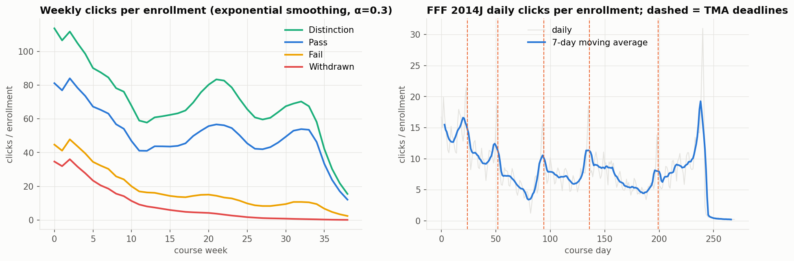

# Module 2 — Exploratory Data Analysis

## 2.1 Distributions and outliers

Activity is strongly right-skewed: total clicks have skewness 3.0 and forum posts 9.5. 4,093 enrollments (12.6%) have
no activity in the course window. Using course-specific 3-IQR fences, 551 enrollments are extreme click outliers. They
are genuine heavy learners, not errors (Module 3).

## 2.2 Correlations: two independent behavioural axes

The Spearman matrix shows two independent groups of variables:
* **Volume and regularity:** clicks, active days, logins, submission rate and score, inter-correlated at ρ 0.7–0.99.
* **Pacing:** deadline concentration, burstiness, last-minute submission and night logins, almost independent of
  volume (|ρ| < 0.25).

The two axes are the basis for personas that are more than "high vs low activity".

## 2.3 Comparisons by course type, cohort and enrollment period

| Comparison | Result |
|---|---|
| Course type | STEM learners are *more* active (median active-day fraction 0.18 vs 0.11) but *more* at risk (55.2% vs 48.2%) and withdraw more (34% vs 25%) |
| Cohort | withdrawal rose from 28.8% / 26.8% (2013B / 2013J) to 33.5% / 34.0% (2014B / 2014J): a year effect, not a B-vs-J effect; this is a drift to monitor |
| Enrollment period | early registrants (> 60 days before start) are the most at risk (55.1%) vs 49.6–50.7% for later registrants |

Kruskal–Wallis tests with ε² effect sizes are in `reports/tables/m2_kruskal_tests.csv`. With n = 32k every test is
significant, so we interpret effect sizes.

## 2.4 Relationships required by the brief

* **Login frequency vs final score:** ρ = 0.74, with diminishing returns. Scores rise steeply up to about 3–4
  logins/week and then flatten. Against the exam score alone the relationship is much weaker (ρ = 0.22).
* **Video completion vs submission timeliness:** ρ = 0.14. Watching videos does not make learners submit earlier, so
  timeliness is a separate behavioural dimension and enters the model on its own.

## 2.5 Time pattern (Lecture 8.1)

Weekly clicks, smoothed with exponential smoothing, have a seasonal component (peaks before each assessment
deadline) on a downward trend. Learners who later fail or withdraw are less than half as active as passers **from week
0**. Behaviour carries an early signal, which motivates the early-warning model in Module 6.

## 2.6 OLAP view (Lectures 2 and 4)

A DuckDB (column-store) star schema stores the enrollment data: `fact_enrollment` with `dim_learner`, `dim_course`
and `dim_presentation`. On it we run the OLAP operations:
* **roll-up:** `GROUP BY ROLLUP(domain, module)`;
* **drill-down and dice:** STEM × 2014 cohorts by IMD band;
* **slice and pivot:** at-risk rate by module × presentation.

The results are in `m2_olap_rollup.csv` and `m2_olap_pivot.csv`.

<!-- pagebreak -->
