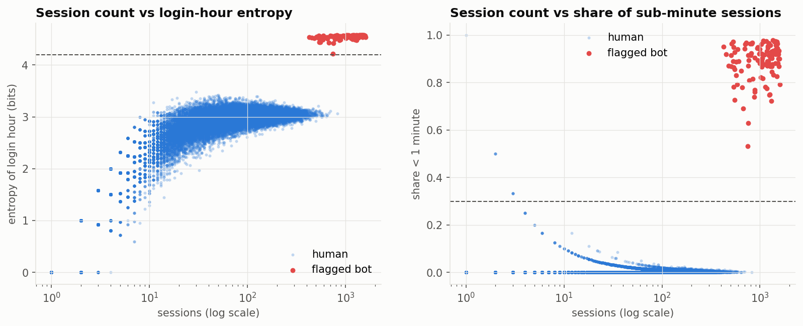
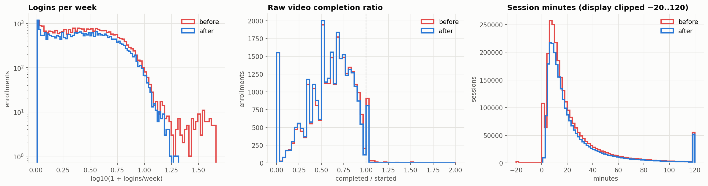
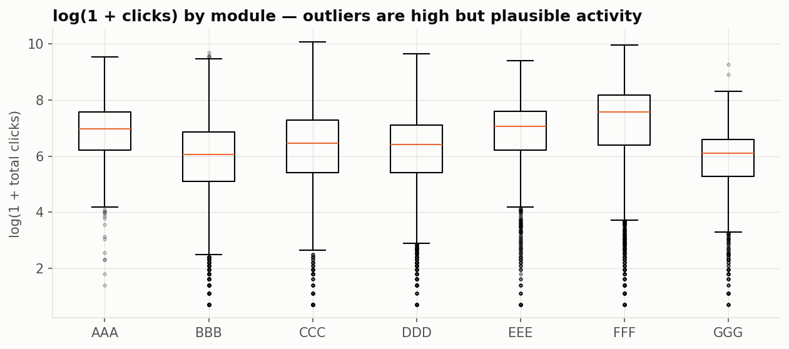

# Module 3 — Data Quality and Cleaning

## 3.1 Quality assessment

| Table | Rows | Completeness | Duplicate keys | Issue |
|---|---|---|---|---|
| studentInfo | 32,593 | 99.7% | 0 | IMD band missing (1,111) and spelled two ways ('10-20' vs '10-20%') |
| studentRegistration | 32,593 | 86.2% | 0 | unregistration date structurally missing for non-withdrawers |
| studentAssessment | 173,912 | 99.98% | 0 | 173 missing scores |
| vle | 6,364 | 72.5% | 0 | week_from / week_to mostly missing (unused) |
| synthetic_login_sessions | 2,709,570 | 99.8% | 21,505 | duplicates, messy labels, invalid durations, bots |

Referential integrity holds between all OULAD tables. Missing values are classified by mechanism (Lecture 7):
* *structural*, e.g. unregistration date for learners who did not withdraw: kept as NA;
* *MCAR-like*, e.g. session minutes: imputed and flagged;
* *not imputable*, e.g. IMD band: an explicit "Unknown" category.

## 3.2 Cleaning actions (each logged with rule, count and justification)

| Issue | Rule | Action | Affected |
|---|---|---|---|
| inconsistent label | IMD '10-20' | relabel to '10-20%' | 3,516 |
| missing | IMD null | 'Unknown' + flag (global constant) | 1,111 |
| duplicates | identical session rows | drop | 21,505 |
| inconsistent labels | 17 device spellings ('PC', ' desktop', 'DESKTOP' …) | map to desktop / mobile / tablet | 212,852 |
| invalid | session minutes < 0 or > 1440 | NA → learner-median imputation + flag | 8,071 |
| invalid | videos completed > started | cap at started | 8,064 |
| bot-like activity | ≥ 2 of 4 rules | drop automated sessions of flagged enrollments | 108,031 sessions / 114 enrollments |
| outliers | clicks > Q3 + 3 IQR within course | keep + flag; transform + winsorise in Module 4 | 551 |

No enrollment is removed: 32,593 → 32,593. The session log goes from 2,709,570 to 2,580,034 rows.

## 3.3 Bot detection: why multiple rules

A single box-plot rule (session count > Q3 + 3 IQR) finds 109 of the 114 bots but also flags **112 heavy human
learners**. We combine four independent signals and flag an enrollment when at least two fire:
1. extreme session count;
2. more than 30% sub-minute sessions;
3. automation user agent;
4. uniform login-hour entropy.

This rule detects all 114 injected bots with **precision 1.00 and recall 1.00**.

| Rule | Flagged | True bots | False positives | Precision | Recall |
|---|---|---|---|---|---|
| r1 extreme session count (IQR) | 221 | 109 | 112 | 0.49 | 0.96 |
| r2 sub-minute sessions | 124 | 114 | 10 | 0.92 | 1.00 |
| r3 automation user agent | 114 | 114 | 0 | 1.00 | 1.00 |
| r4 uniform login hours | 114 | 114 | 0 | 1.00 | 1.00 |
| **≥ 2 of 4** | **114** | **114** | **0** | **1.00** | **1.00** |

<!-- pagebreak -->
