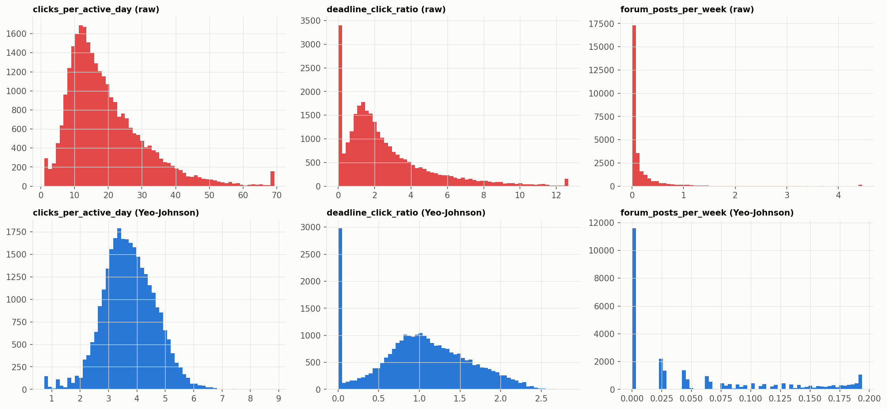
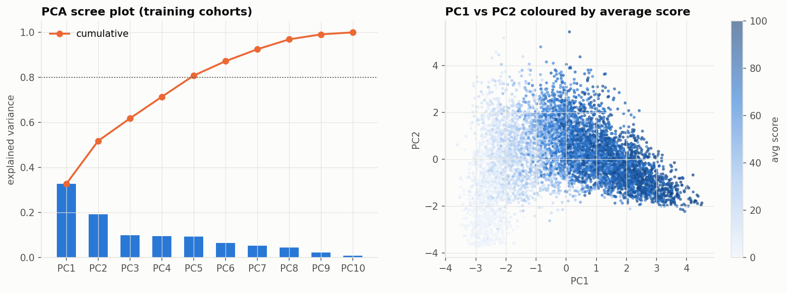

# Module 4 — Feature Engineering

## 4.1 Candidate features

We integrate the cleaned OULAD data and the session and submission aggregates into one row per enrollment, with 19
candidate behavioural features:

* **RFM:**
  * *Recency:* time since the last activity, as a fraction of course length.
  * *Frequency:* active-day fraction and logins per week.
  * *Monetary (intensity):* clicks per active day.
* **Consistency and pacing:** weekly burstiness within the active span; deadline click ratio (share of clicks on
  deadline days ÷ share of days that are deadline days); last-minute submission share; night-login share.
* **Performance:** average score over *scheduled* assessments, where a non-submission counts as 0; on-time rate.
* **Content and social:** video completion rate (smoothed); forum posts per week.

**Excluded on purpose:**
* demographics (gender, age, disability, IMD, region, education), to keep the segmentation fair. They are kept for
  profiling with one-hot and ordinal encodings;
* `final_result`, to avoid target leakage. It is used only for external validation.

## 4.2 Selection

We apply a redundancy filter: for every pair with |ρ| ≥ 0.80 we keep the more interpretable feature. This leaves 10
features with maximum remaining |ρ| = 0.80. For example, logins per week correlates 0.99 with active-day fraction and
is dropped.

| Role | Feature | Source |
|---|---|---|
| R | recency_fraction | OULAD |
| F | active_day_fraction | OULAD |
| M (intensity) | clicks_per_active_day | OULAD |
| Consistency | weekly_cv_active_span | OULAD |
| Pacing | deadline_click_ratio | OULAD |
| Performance | avg_score_scheduled | OULAD |
| Timeliness | last_minute_submission_share | synthetic |
| Content | video_completion_rate | synthetic |
| Social | forum_posts_per_week | synthetic |
| Rhythm | night_login_share | synthetic |

## 4.3 Transformation and scaling (Lecture 7)

| Feature | raw skew | log1p | Box-Cox(x+1) | Yeo-Johnson | rank-normal |
|---|---|---|---|---|---|
| total_clicks | 2.93 | −0.93 | −0.04 | −0.04 | 0.01 |
| clicks_per_active_day | 1.99 | −0.37 | 0.02 | 0.02 | 0.01 |
| deadline_click_ratio | 1.84 | 0.11 | 0.01 | 0.01 | 0.18 |
| forum_posts_per_week | 9.47 | 3.59 | 0.83 | 0.83 | 0.65 |

**Transformation.** Yeo-Johnson (the Box-Cox family, extended to zeros) brings skewness close to 0. Rank-normal
scores do as well, but they cannot be applied to a single new learner, so they are not suitable for deployment.

**Scaling.** Without scaling, `avg_score_scheduled` carries **99.8%** of the variance in the distance. After z-score
scaling every feature carries 10%. Min-max and robust scaling leave large imbalances (4.7–17.5%).

**Final pipeline:**
1. median fill;
2. winsorise at p0.5 / p99.5;
3. Yeo-Johnson on the skewed features;
4. z-score.

The pipeline is fitted on 2013B–2014B only. 2014J is held out as an unseen cohort.

## 4.4 PCA

PC1 (33% of variance) is *engagement and performance*. PC2 (19%) is *pacing*, which confirms the two axes found in the
EDA. Five PCs are needed for 80% of the variance. Clustering on those five PCs does not improve separation measured in
the original space (silhouette 0.171 either way). We therefore cluster on the 10 interpretable features and use PCA
for visualisation.

<!-- pagebreak -->
