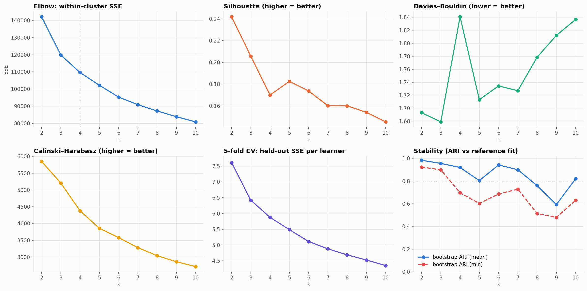
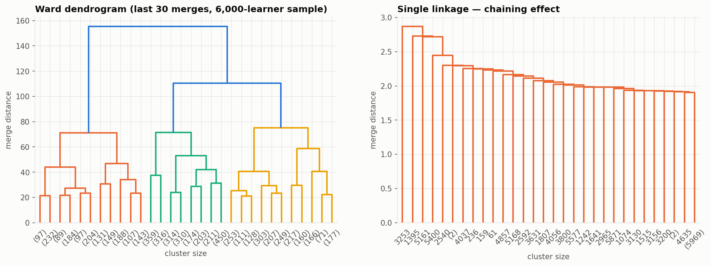
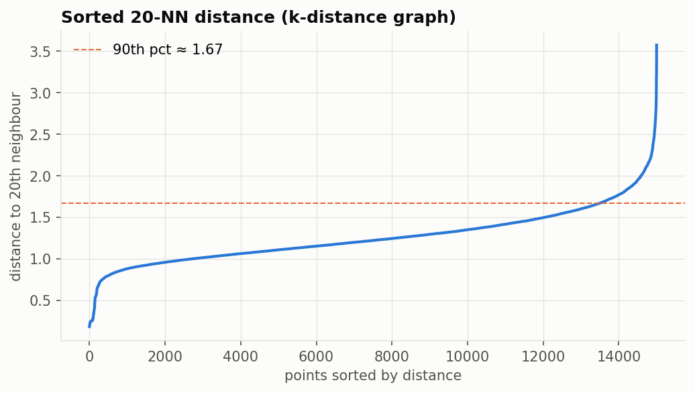
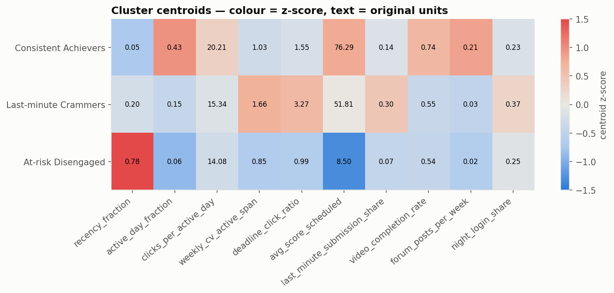
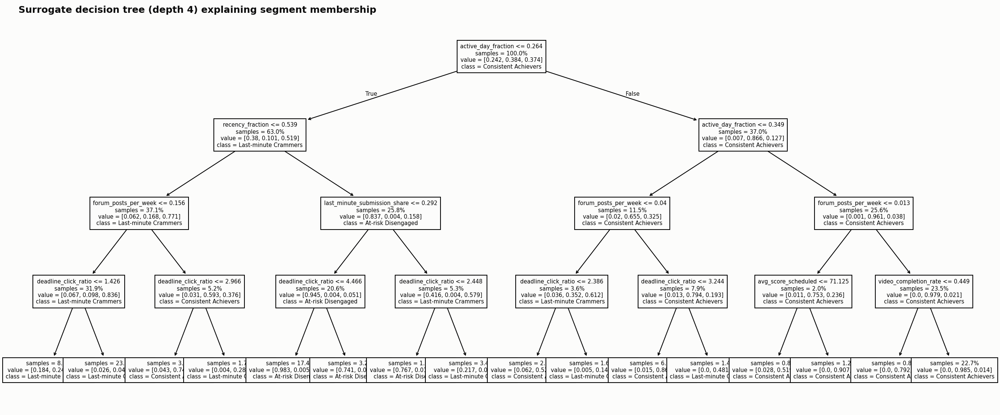

# Module 5 — Model Development

## 5.1 Is there structure?

The Hopkins statistic is **0.76**, well above 0.5, so the data has clustering tendency. Non-starters (no activity) form
a degenerate point mass, so they are assigned by rule as **S0**. They are not allowed to distort the K-Means
centroids.

## 5.2 K-Means: choosing k

We scan k = 2…10 and compute for each:
* SSE (elbow);
* five-fold held-out SSE (cross-validation);
* silhouette, Davies–Bouldin and Calinski–Harabasz;
* bootstrap ARI over 20 resamples;
* seed ARI.

| k | Silhouette | Davies–B. | CH | Min share | Bootstrap ARI mean / min | Seed ARI |
|---|---|---|---|---|---|---|
| 2 | 0.242 | 1.69 | 5852 | 37.4% | 0.98 / 0.92 | 0.99 |
| **3** | **0.206** | **1.68** | **5208** | **24.2%** | **0.96 / 0.90** | **0.98** |
| 4 | 0.170 | 1.84 | 4378 | 19.3% | 0.92 / 0.70 | 0.72 |
| 5 | 0.183 | 1.71 | 3857 | 10.1% | 0.80 / 0.60 | 0.76 |
| 6 | 0.174 | 1.73 | 3580 | 8.9% | 0.94 / 0.69 | 0.64 |

The elbow (chord distance) points to k = 4, but k ≥ 4 is **not stable**: bootstrap ARI minimum < 0.80, and different
seeds give different partitions. We require stability ≥ 0.80. Among the stable k, k = 3 has the best Davies–Bouldin
score and splits the active learners into actionable groups. k = 2 only separates "high" from "low". The empirical
rule √(n/2) ≈ 97 is far too large for actionable personas.

## 5.3 Hierarchical clustering (AGNES)

Linkages are compared on a 6,000-learner sample, because memory grows with O(n²):

| Linkage | Cophenetic r | Silhouette | Largest cluster |
|---|---|---|---|
| single | 0.31 | 0.21 | 99.97% (chaining) |
| complete | 0.48 | 0.10 | 41.8% |
| average | 0.61 | 0.16 | 96.8% |
| Ward | 0.52 | 0.15 | 39.0% |

Single and average linkage chain everything into one cluster, the classic weakness taught in Lecture 9. Ward gives
balanced clusters but agrees with K-Means only moderately (ARI 0.44). It also cannot assign new learners without
refitting.

## 5.4 DBSCAN

The k-distance graph (k = MinPts = 20) suggests Eps ≈ 1.4. The Eps × MinPts grid shows that the data is **one dense
continuum** with sparse fringes. The best setting (≤ 10% noise, ≥ 2 clusters) gives one cluster with 91% of learners,
plus 8% noise. DBSCAN is therefore used as an outlier lens, not as the segmentation.

## 5.5 Algorithm comparison and choice

| Algorithm | Clusters | Silhouette | Davies–B. | Largest cluster | Stability | Assigns new learners |
|---|---|---|---|---|---|---|
| **K-Means (k = 3)** | 3 | 0.206 | 1.68 | 38% | 0.96 | yes (nearest centroid) |
| Agglomerative Ward | 3 | 0.150 | 2.02 | 39% | 0.44 vs K-Means | no |
| DBSCAN (1.4, 20) | 2 + noise | 0.253 | 0.96 | 91% | – | partly |

DBSCAN has the highest silhouette, but only because it puts almost everyone in one cluster, which is useless for
tailoring. **K-Means** is selected because it has the best balance of separation, stability, scalability (O(nkt)) and
instant assignment in the API.

## 5.6 Validation

* **Internal:** silhouette 0.21 is typical of behavioural data that forms a continuum. Every cluster has a positive
  mean silhouette, and fewer than 2% of members have a negative silhouette.
* **External** (outcome never used): purity 0.63, NMI 0.31, ARI 0.23 against `final_result`. Segments describe
  behaviour, not outcomes, so a moderate value is expected. What matters is that pass rates differ sharply by segment.
* **Temporal:** the frozen model on the unseen 2014J cohort has silhouette 0.19, and ARI 0.84 against a K-Means refit
  on 2014J.
* **Robustness:** a model built only on real OULAD features agrees with the full model at ARI 0.69, so the core
  structure comes from real data, not from the synthetic layer.
* **Explainability (Lecture 10):** a depth-4 decision tree reproduces the segments with **87%** accuracy on test and
  2014J. Its rules are shown in the dashboard. The main splits are active-day fraction (importance 0.47), recency
  (0.33) and deadline click ratio (0.07).

<!-- pagebreak -->
