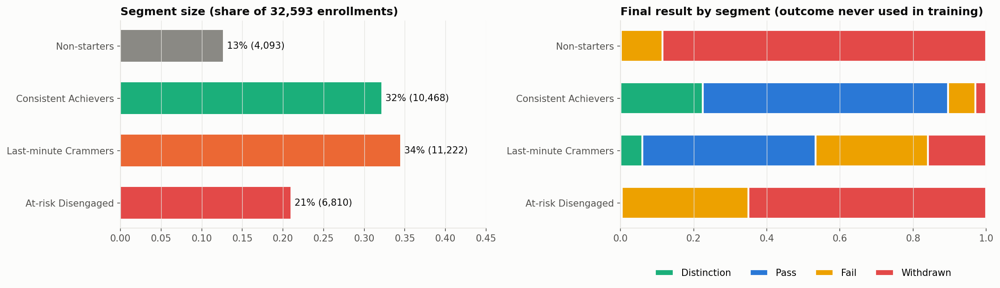
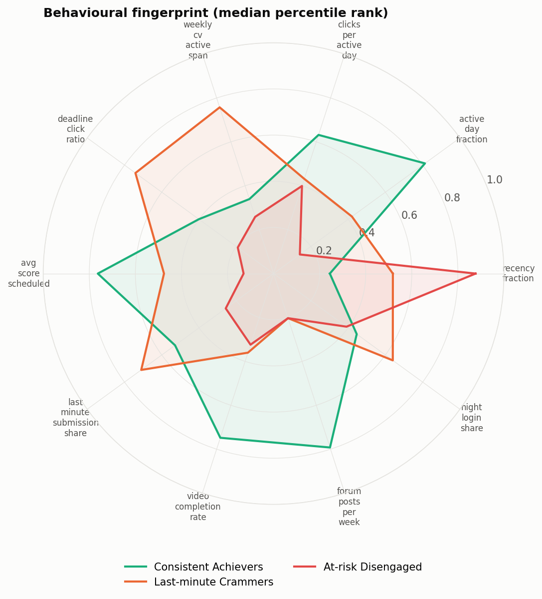
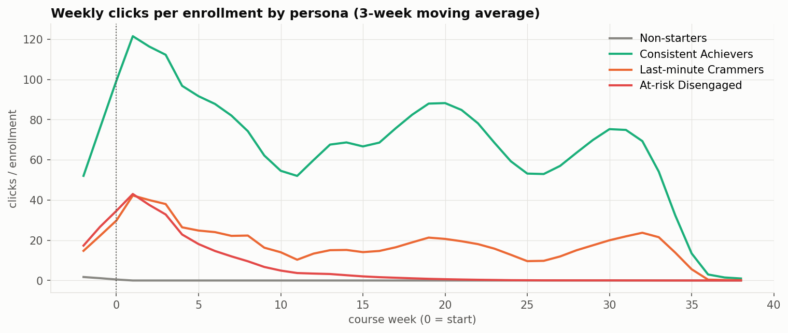
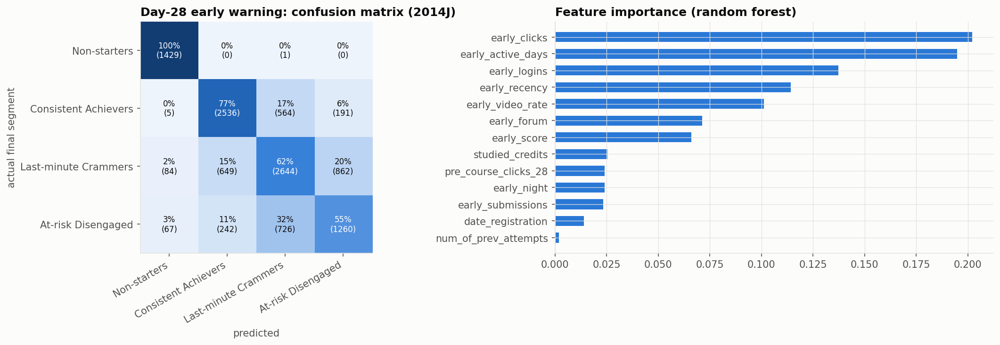
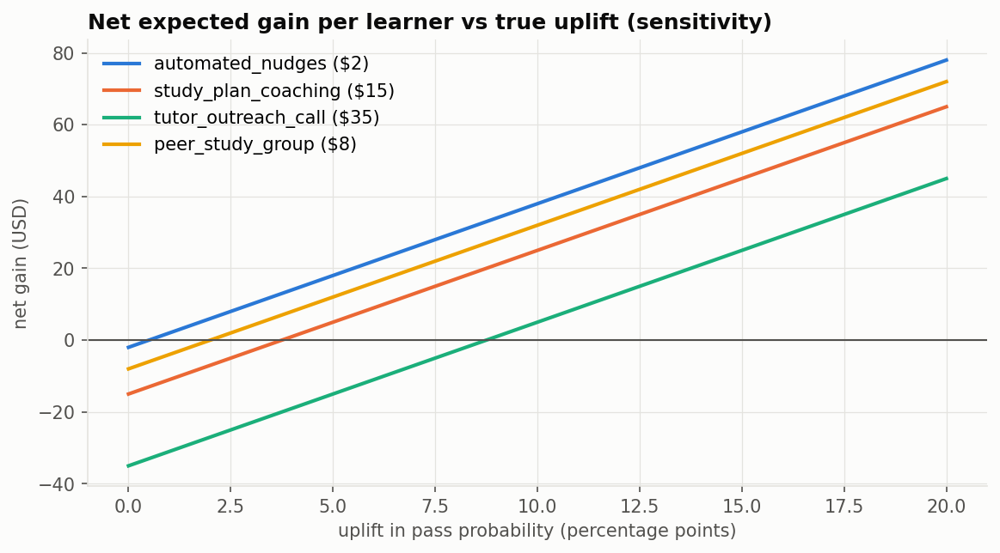
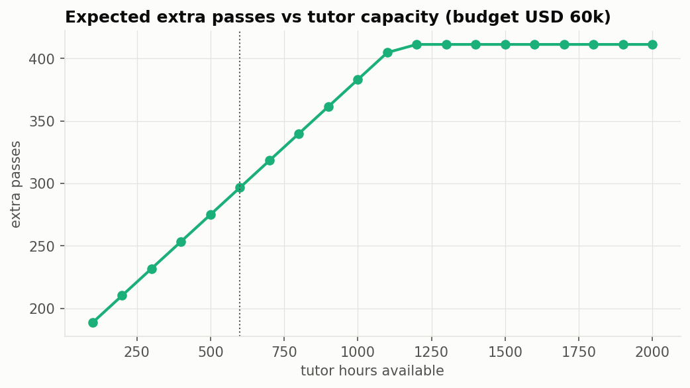
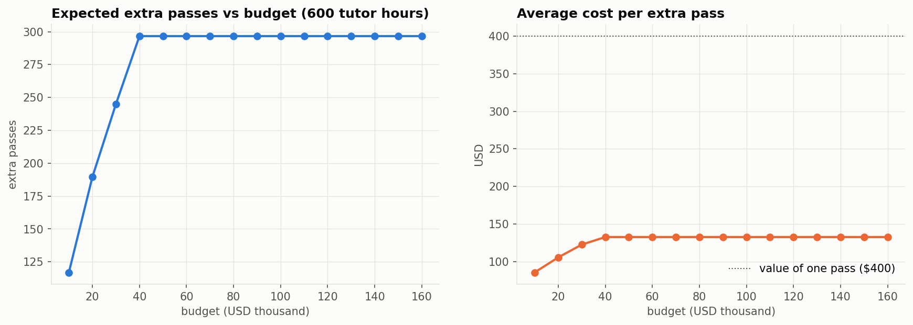
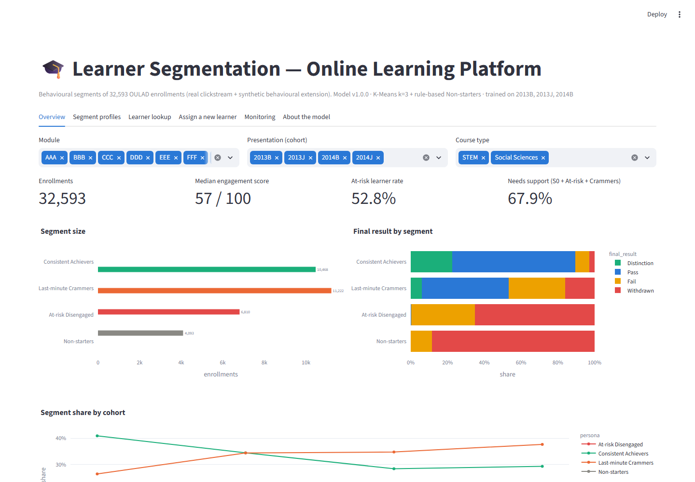
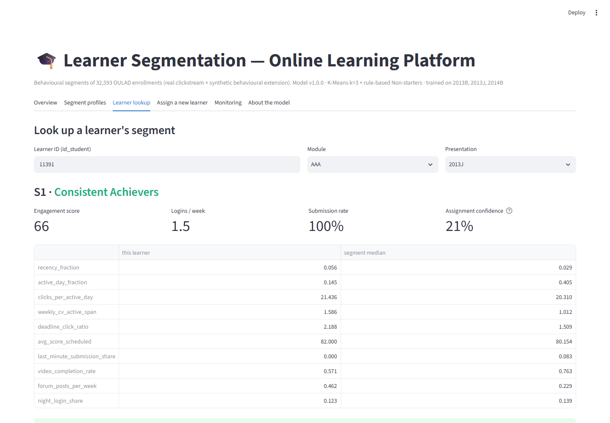
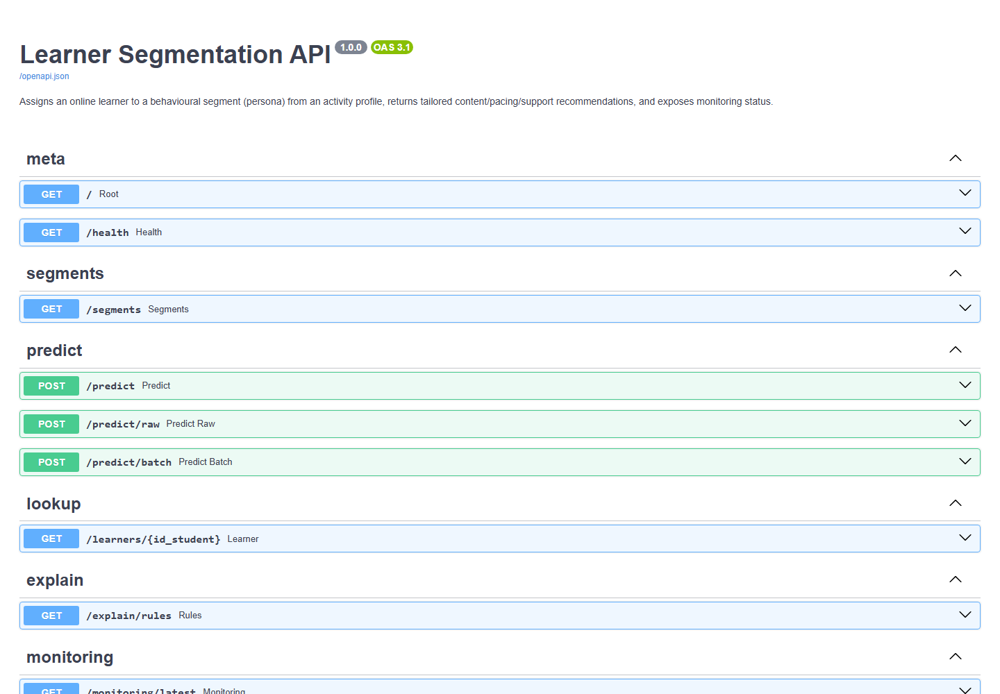

# Module 6 — Personas, Recommendations and Deployment

## 6.1 Personas

Clusters are named by matching their centroids to predefined behavioural archetypes (Hungarian assignment). Names
therefore stay consistent when the model is refit.

| Median | S0 Non-starters | S1 Consistent Achievers | S2 Last-minute Crammers | S3 At-risk Disengaged |
|---|---|---|---|---|
| active-day fraction | 0 | 0.41 | 0.14 | 0.03 |
| recency (fraction of course since last activity) | 1.00 | 0.03 | 0.10 | 0.84 |
| deadline click ratio | – | 1.5 | **3.4** | 0.7 |
| last-minute submission share | – | 0.08 | **0.25** | 0 |
| hours before deadline (median) | – | **41** | 2.7 | 4.8 |
| average score (scheduled) | 0 | **80** | 58 | 5 |
| forum posts / week | 0 | 0.23 | 0 | 0 |
| logins / week | 0 | 3.9 | 1.3 | 0.3 |
| pass rate | 0.1% | 89.6% | 53.3% | 0.3% |
| withdrawal rate | 88.5% | 3.0% | 16.0% | 65.0% |

At-risk Disengaged and Crammers start with **the same first-month activity**: a median of 39.5 vs 39.3 clicks. They
separate after week ~10, when S3 learners stop. This explains why early detection of S3 is hard (§6.3) and why the
14-day inactivity alert is the key intervention.

## 6.2 Tailored content, pacing and support

| Persona | Content | Pacing | Support | KPI to track |
|---|---|---|---|---|
| Non-starters | short "first-hour" orientation, the first activity unlocked immediately | welcome sequence day 1 / 3 / 7 | tutor call by day 10; deferral / withdrawal-refund advice | share active by day 14 |
| At-risk Disengaged | catch-up pathway with essential content only | flexible deadlines on request | alert at 14 days inactive → tutor outreach | re-engagement within 14 days of alert |
| Last-minute Crammers | split assessments into weekly micro-tasks, short videos | mini-deadlines 3–5 days before each due date | study-plan coaching; deadline reminders 72 h before | share submitted > 24 h before deadline |
| Consistent Achievers | enrichment and stretch material | self-paced | peer-mentor role, forum moderation; no paid support | distinction rate, mentor uptake |

**Fairness.** Demographics are not model inputs. The association between segment and each attribute is weak
(Cramér's V: gender 0.05, disability 0.06, education 0.08, IMD 0.09, age 0.10, course domain 0.11).

## 6.3 Early warning on day 28 (Lecture 10)

Segments use the whole course, but support must start early. A random forest predicts the segment from information
available after 28 days. It is trained on 2013B–2014B and tested on unseen 2014J.

| Class | Precision | Recall |
|---|---|---|
| Non-starters | 0.90 | **1.00** |
| Consistent Achievers | 0.74 | 0.77 |
| Last-minute Crammers | 0.67 | 0.62 |
| At-risk Disengaged | 0.55 | 0.55 |

Balanced accuracy is **0.74** (chance level is 0.25). Non-starters can be found with near certainty in the first
month. At-risk Disengaged is the weakest class because those learners still look like Crammers. We recommend a
weekly-refreshed watch list, confirmed by tutors.

## 6.4 Decision analysis (Lecture 2)

For each persona we compare EV(no action) = pass rate × $400 with EV(intervene) = (pass rate + uplift) × $400 − cost.
The uplift is scaled by the segment's headroom. Costs already spent are sunk and excluded.

| Persona | Best intervention | Uplift | Cost | Net gain / learner | Break-even uplift |
|---|---|---|---|---|---|
| At-risk Disengaged | tutor outreach call | 15 pp | $35 | **+$25.0** | 8.8 pp |
| Last-minute Crammers | study-plan coaching | 9.6 pp | $15 | **+$23.4** | 3.8 pp |
| Non-starters | tutor outreach call | 12 pp | $35 | +$13.0 | 8.8 pp |
| Consistent Achievers | automated nudges | 0.4 pp | $2 | **−$0.4** | 0.5 pp |

Support for Achievers destroys value. For the other segments the decision is positive as long as the true uplift is
above the break-even uplift. The sensitivity chart shows how the decision changes with uplift.

## 6.5 Optimisation (Lecture 3.2)

The LP, solved with scipy HiGHS, chooses how many learners of each segment receive each intervention:
* **Objective:** maximise expected extra passes.
* **Constraints:** budget $60,000; tutor time 600 hours; each learner receives at most one intervention; no option with
  negative EV.
* **Data:** 2014J segment sizes.

| Segment | Intervention | Learners | Spend | Extra passes |
|---|---|---|---|---|
| Last-minute Crammers | study-plan coaching | 1,800 | $27,000 | 172.8 |
| Last-minute Crammers | automated nudges | 2,439 | $4,878 | 58.5 |
| At-risk Disengaged | automated nudges | 2,295 | $4,590 | 36.7 |
| Non-starters | automated nudges | 1,430 | $2,860 | 28.6 |
| **Total** | | **7,964** | **$39,328** | **296.7** |

| Policy | Learners | Extra passes | Spend | Cost per extra pass |
|---|---|---|---|---|
| segment-blind tutor calls (same tutor hours) | 800 | 66.1 | $28,000 | $423.6 |
| **segment-targeted LP** | 7,964 | 296.7 | $39,328 | **$132.6** |

**Sensitivity (shadow prices).** The budget constraint is **not binding**: its shadow price is 0, and $20.7k is
unspent. **Tutor time is binding.** One extra tutor hour adds about 0.22 passes, worth about $86, which is more than
its cost. The recommendation is therefore to buy tutor hours, not to raise the budget. Tutor time goes to coaching for
Crammers, where it buys the most passes per minute.

## 6.6 Deployment as a decision-support system (Lecture 3.1)

The system has the three DSS components:
* **data management:** learner lookup table and feature store (Parquet);
* **model management:** versioned feature pipeline, K-Means, persona rules and surrogate tree (joblib);
* **user interface:** a Streamlit dashboard for learner-success staff and tutors.

The components are connected through a **FastAPI** service.

| Endpoint | Purpose |
|---|---|
| `GET /health`, `GET /segments` | status, model version, persona catalogue |
| `POST /predict` | assign one learner from the 10 engineered features |
| `POST /predict/raw` | assign from raw LMS counts (active days, clicks, scores, videos, logins …), using the training definitions |
| `POST /predict/batch` | assign many learners; returns segment counts |
| `GET /learners/{id_student}` | segment, confidence and recommendations of an existing learner |
| `GET /explain/rules`, `GET /monitoring/latest` | decision rules, latest monitoring verdict |

Every response contains the segment, persona, assignment confidence, an atypical flag (distance beyond the training
p95), the top drivers and the recommended actions. Pydantic validation rejects impossible inputs, and all 7 invalid
test cases are rejected (422 / 404). The served assignments agree **100%** with the training notebook on 2,000
learners. Median latency is 49 ms per request. Predictions are logged for monitoring.

The dashboard has six tabs: KPI overview with module / cohort / course-type filters, segment profiles, learner lookup,
assignment of a new learner (through the API, falling back to the in-process model), monitoring, and the model card.

The cloud configuration is included: `render.yaml` (Render blueprint for the API and dashboard), Streamlit Community
Cloud settings and a `Dockerfile` for Hugging Face Spaces. Instructions are in `docs/DEPLOYMENT.md`. Live links:
https://learner-segmentation-api.onrender.com · https://learner-segmentation-dashboard.onrender.com.

<!-- pagebreak -->
