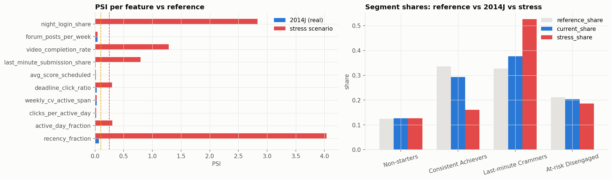
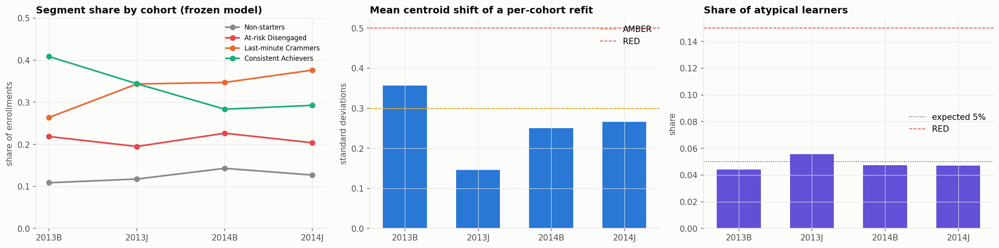

# Module 7 — Model Monitoring

## 7.1 Signals and triggers

| Check | Signal | AMBER | RED |
|---|---|---|---|
| Feature drift | PSI per feature (10 reference quantile bins) | any > 0.10 | ≥ 2 features > 0.25 |
| Segment share | largest change of a segment's share | > 5 pp | > 10 pp |
| Centroid shift | K-Means refit on the batch, matched to production centroids (Hungarian), mean shift in SD | > 0.30 | > 0.50 |
| Atypical share | distance to nearest centroid > training p95 (expected 5%) | > 8% | > 15% |
| Structure | silhouette drop vs training | – | > 0.05 |

**Decision rule:**
* ≥ 2 RED → **RE-CLUSTER**;
* 1 RED or any AMBER → **INVESTIGATE**;
* otherwise **NO ACTION**.

KS tests and the Evidently report are kept as supporting evidence. Their p-values are not used as triggers, because
with about 10,000 learners almost any difference is "significant". The full procedure is in
`docs/MONITORING_PLAYBOOK.md`.

## 7.2 Results

| Batch | Max PSI | Features RED | Share shift | Centroid shift | Atypical | Evidently drifted | Decision |
|---|---|---|---|---|---|---|---|
| 2014J (real, unseen) | 0.07 | 0 | 4.9 pp | 0.27 SD | 4.7% | 2 / 10 | **NO ACTION** |
| Stress scenario (simulated platform change) | > 0.25 | 6 | 19.9 pp | 1.83 SD | 12.3% | 7 / 10 | **RE-CLUSTER** |

The stress scenario simulates a platform redesign combined with exam-season pressure. Active learners study on
20–45% fewer days, shift about 25 pp of logins to the night, submit more at the last minute, concentrate 1.3–1.9× more
activity on deadline days, and complete 15 pp fewer videos. The triggers fire as designed. On the real cohort they stay
green, so the system neither raises false alarms nor misses real change.

## 7.3 Stability over time

| Cohort | Silhouette | Centroid shift (SD) | Atypical | Achievers | Crammers | At-risk | Non-starters |
|---|---|---|---|---|---|---|---|
| 2013B | 0.222 | 0.36 | 4.4% | 40.9% | 26.4% | 21.9% | 10.9% |
| 2013J | 0.199 | 0.15 | 5.6% | 34.4% | 34.4% | 19.5% | 11.8% |
| 2014B | 0.193 | 0.25 | 4.8% | 28.4% | 34.7% | 22.6% | 14.3% |
| 2014J | 0.193 | 0.27 | 4.7% | 29.3% | 37.7% | 20.4% | 12.7% |

The structure is stable, but the mix is moving: Consistent Achievers fell from 41% to 29%, and Last-minute Crammers
rose from 26% to 38%. This matches the rise in withdrawal found in the EDA. The playbook adds a trend rule: if the
same segment moves in the same direction for three cohorts, the status becomes INVESTIGATE.

Evidently HTML reports: `monitoring/evidently_drift_2014J.html` and `monitoring/evidently_drift_stress_scenario.html`.
They are also embedded in the dashboard's Monitoring tab.

<!-- pagebreak -->
